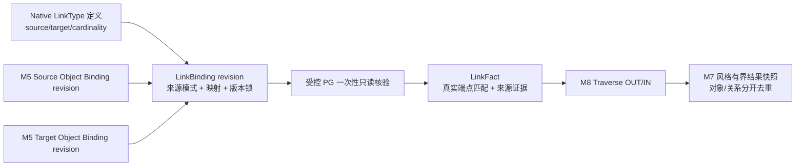

# M8 · LinkType / LinkFact 第一轮产品需求与领域模型评审（R1）

> **状态：R1 Review Candidate / 待产品所有者评审。** 2026-10-19。仅含设计与验收候选；**非 UX-Low 签收、非 OFIP 正式决策、非生产代码实施、非发布**。
>
> 上位任务：[M8 #47](https://github.com/gitfortian/ontoforge/issues/47)；正式设计草案：[OFIP-0010](../proposals/OFIP-0010-M8-LinkFact与有界遍历.md)（**Discussion / Decision Pending / Implementation Not Started**）；前置已合并：[M7 PR #75](https://github.com/gitfortian/ontoforge/pull/75)。本文不替代/修改 OFIP-0010 与 Native V0.2 机器合同，待评审结论回填同一权威提案。
>
> **审查依据（AS-IS）**：2026-10-19 的 `main`：Native V0.2 `linkType` 声明提供 `id/apiName/sourceTypeRef/targetTypeRef/cardinality/evidenceRequired`；M5 `DataBindingService` 仅提供单对象类型的本机 PG 来源绑定和不可变 revision；M7 `ObjectSetQueryService` 交付 `local-query-v1` 的有界结果快照/签名分页/授权与来源复核；既有 `traceSet` 为固定制造场景的真实双跳查询，**不是通用 LinkBinding**。

## 1. 产品目标与范围

### 1.1 用户要解决的工作

用户已经定义、冻结并绑定了两个自己的 ObjectType（例如 `equipment` 与 `inspection-lot`），也定义了 LinkType `equipment-inspections`。目前只能说明“模型里允许这种关联”，**不能证明任何实例之间真的存在关系**。

M8 的用户目标是：**明确绑定关系来源 → 验证端点身份和语义 → 保存不可变 LinkBinding → 查询真实 OUT/IN LinkFact → 找到可核验的源列与版本证据 → 失败后修复并重新执行**。

成功不只是一张关系图，也不只是一条 SQL：用户必须能区分（1）LinkType 定义，（2）LinkBinding 来源配置，（3）LinkFact 已核验的实例事实，以及（4）输出的 ObjectSet 与路径统计。

### 1.2 三个独立验收的纵向切片（不混合提前交付）

| 切片 | 选择的用户可见能力 | 明确不在该切片内 |
| --- | --- | --- |
| **M8.1 首交付（优先）** | 用户自建 LinkType 的 **FOREIGN_KEY** 映射、双端 Binding 锁、校验与 CAS 保存、正反向单跳、去重与来源证据、失败恢复；完整前后端/真实 PG17/Chromium | 桥表、两跳路径、动态 Graph DSL、关系写回 |
| **M8.2 第二切片** | 同一受控 PG 内 **BRIDGE_TABLE** 映射及 M:N 单跳；沿用已验收的一跳执行和 UI | 两跳与任意多跳、跨源 JOIN |
| **M8.3 第三切片** | 两段显式 Typed Traverse 的恰好两跳；分别核验对象/LinkFact/路径去重、扇出预算、循环和自关联 | 递归遍历/无界深度、图索引、任意路径表达式 |

**范围建议：** M8.1 重点验证 ONE_TO_ONE、ONE_TO_MANY、MANY_TO_ONE；MANY_TO_MANY 的多对多物理表达由 M8.2 桥表完整交付。若用户定义的 LinkType 为 MANY_TO_MANY，而给定单列外键无法证明该关系，M8.1 显示“不支持该映射模式”，而非静默更改基数。四种基数的统一回归可在 M8.2 收口，M8.1 仍需按已声明基数正反双端验证。

### 1.3 当前明确非目标

不改造 Native V0.2 的发布/索引/授权机器合同；不新增 Graph Engine、不推理制造 LinkFact、不允许任意 SQL；不支持跨包合并同键身份、跨数据库 Join、源行事件多重边/时态关系、正式 SchemaRelease/IndexSnapshot、Agent 或 Action；现有 `mvp-local` 仍只允许隔离测试环境，生产级角色/细粒度行权限不是此切片已实现能力。

## 2. M8.1 用户故事地图（面向真实操作）

| 步骤 | 用户意图与操作 | 可见结果 | 必须覆盖的恢复/失败 |
| --- | --- | --- | --- |
| U1 选择模型 | 选择已冻结 Local Snapshot 的 LinkType，看到 source/target 及基数 | 显示“模型定义；尚无实例事实” | 无 LinkType/未冻结/无读取授权，不展示假关联 |
| U2 选择端点 | 分别选择该 Snapshot 下已保存、已验证的 source/target Object Binding revision | 展示端点身份域、主键类型、来源表、锁定版本摘要 | 不同快照/包、缺失/漂移 Binding、错端点拒绝 |
| U3 配置关系 | 选择 FK 位于 SOURCE 或 TARGET 端，明确其来源列，以及被引用端主键列 | 系统说明原始 LinkType 方向不因 FK 位置变化；列只从允许来源挑选 | 列不存在、类型不兼容、未经确认的同名列不自动映射 |
| U4 预演与校验 | 发起有界、只读验证，核对匹配、合法 NULL、非空孤儿、物理重复及基数冲突 | 精确标示此次验证范围与是否完整，不以抽样冒充全表认证 | 身份冲突/基数冲突/无权/超预算：FAILED，无伪 0 |
| U5 保存与重开 | 确认校验后以 expectedRevision CAS 保存 LinkBinding，刷新重开指定修订 | 返回 bindingId/revision/digest + 所锁端点版本 + 来源结构指纹 | 409 CAS 冲突不丢编辑；保存响应丢失先查状态、不能无脑新建 |
| U6 一跳 OUT | 从具体 source ObjectRef 或明确 root ObjectSet 选择“查询关联对象” | 显示去重的 target 对象、关系数、状态/证据、结果快照分页 | 根对象缺失与真实空关联区分 |
| U7 一跳 IN | 从 target 反查关联 source | LinkFact 原始 source/target 不变，仅遍历输入输出方向交换 | 无权反查、反向基数异常 fail-closed |
| U8 检查质量/修复 | 点击关系或失败详情，看到来源、锁定版本、证据、断链原因 | 跳回关系映射审阅→修订→复验→新结果执行 | DDL 漂移、撤权、过期 410、重启失效、无业务水位 UNKNOWN |

**首轮黄金故事（自定义领域，无固定制造 switch）**：
- 新建 `equipment`（设备）、`inspection-lot`（检验批次）；LinkType `equipment-inspections` 定义为 `Equipment → InspectionLot`、`ONE_TO_MANY`、`evidenceRequired=true`。
- 在本机受控 PG 两张来源表分别保存 M5 Object Binding；`inspection_lot.equipment_code` 是位于 **TARGET** 端的 FK，引用 `equipment.equipment_code`（源端已绑定 PK）。设备 EQ-001 的检验批次 LOT-11、LOT-12，正向返回两个去重目标；LOT-11 反向返回 EQ-001；不更改原始 LinkFact 方向。
- LOT-13 的 FK 为 SQL NULL：无 LinkFact，统计“合法空关系”；LOT-14 的非空 FK 指向不存在的设备：仅在具备两端读取资格且覆盖该请求范围的前提下，报告断链和 `PARTIAL / KNOWN_SUBSET`，不能返回 `COMPLETE/0` 掩盖。
- 物理重复事实不复制同一逻辑 LinkFact；一端多条非法关联时按 `ONE_TO_MANY` 反向基数拒绝。来源表/字段改变、权限撤销或 cursor 过期必须有明确错误与新执行入口。
- 只使用测试模型/数据（`ontoforge_test_*`），**不连接真实工业源或改用户现存生产库**。

## 3. 领域模型与权威责任边界

| 概念 | 主责/身份 | 不能混淆为 |
| --- | --- | --- |
| **LinkTypeDefinition** | Native Local Snapshot 内不可变 `linkTypeId` + sourceTypeRef / targetTypeRef / cardinality / evidenceRequired | 某两对象之间已经存在的实例边 |
| **EndpointBindingLock** | 两份明确的 M5 Object Binding `bindingId/revision/digest/sourceId/snapshotId/identityDomainId` | 客户端输入任意表列或“最新版本” |
| **ForeignKeyMapping** | 外键所在端（SOURCE/TARGET）、绑定来源表中的 FK 列、另一端已绑定的主键列、严格兼容的标量等值匹配 | 同名列推断、字符串 cast/trim/大小写归一 |
| **LinkBindingRevision** | `linkBindingId/revision/digest`；保存校验报告、来源 schema 指纹、端点版本锁、expectedRevision CAS；revision 不可变 | LinkType 编辑、source 数据快照、正式发布 |
| **LinkFact** | 逻辑键为 `(Local Snapshot, LinkType, source ObjectRef, target ObjectRef)`；包含当前查询的真实匹配与 SourceReadRef | SQL 中的一行、ObjectRef 本身、关系路径 |
| **TraversalStep** | 绑定 LinkType + LinkBinding 显式修订 + `OUT/IN` + `maxDepth=1`；首交付仅一步 | 按界面视觉方向更改 LinkType 原始定义 |
| **TraversalExecution / Result** | 完整端点和 LinkBinding 版本闭包 + 同次读取证据；对象/LinkFact/路径分别计数，冻结结果并分页 | PG 历史 MVCC 快照或永不过期 ObjectStore |

### 3.1 不可变版本闭包

一条可查询 LinkBinding 至少冻结：
- 同一个 `LOCAL_SNAPSHOT` 的 packageId/snapshotId/类型摘要、linkTypeId 与定义 hash；
- source 与 target Object Binding 的明确 `bindingId/revision/digest`、源白名单 ID、schema/table/key 与 fingerprint；
- FK 关系列和列类型、映射方向、基数、映射 digest、LinkBinding `revision`；
- 此次查询涉及的主体读取授权和实际来源可达性需要在**执行时与每一页**再核验，保存时的校验不是永久授予权限。

若新修订或 DDL 漂移发生，历史修订可只读查看，但不能静默升级/按同名列重绑；根据当前资格拒绝新执行，提示修复并保存新修订。

### 3.2 双端基数（始终以 LinkType 的 SOURCE → TARGET 为准）

| 声明 cardinality | 每个 SOURCE 最多 TARGET | 每个 TARGET 最多 SOURCE |
| --- | ---: | ---: |
| ONE_TO_ONE | 1 | 1 |
| ONE_TO_MANY | 不限制 | 1 |
| MANY_TO_ONE | 1 | 不限制 |
| MANY_TO_MANY | 不限制 | 不限制 |

实际 FK 位置与基数相互约束：SOURCE FK 自然表达 source→单个 target，TARGET FK 自然表达 target→单个 source；仅当源约束与数据核验共同支持时允许 ONE_TO_ONE。不强制将“有数据但违反声明”降级为另一 cardinality。必须在请求涉及的**两端可读事实闭包**中校验约束，不能先过滤隐藏冲突。

### 3.3 质量、身份和重复事实

- `NULL` FK 表示未声明关系，记录在有权限的请求范围内的合法空引用计数；空字符串是 STRING 的精确值，不等同 NULL。
- 非空引用但找不到目标：`ORPHAN`，仅在两端可完整核验时返回已知子集和 `PARTIAL/KNOWN_SUBSET`；跨权限边界不泄露目标存在性。
- 同一 ObjectRef 对应冲突的关键属性/外键：`OBJECT_IDENTITY_CONFLICT`，本次 FAILED；重复且相同的物理行合并为一个 LinkFact，另有物理重复证据计数。
- 一跳结果 `objectCount` 按输出端 ObjectRef 去重、`linkCount` 按逻辑 LinkFact 去重；`pathCount` 在 M8.1 与 `linkCount` 可一致，但必须独立定义，**不得推导 M8.3 路径数必等于对象数**。
- `evidenceRequired` 为真时必须确认能返回合同要求的实际来源表/列及读取证据；若业务要求永久行级定位而源表缺稳定行主键，须明示“行级定位不可用”或拒绝需要该能力的配置，不能把 PostgreSQL `ctid` 伪造成长期身份。

## 4. 交互形态候选（尚不是 UX-Low）

建议沿用现有本体建模/Binding/ObjectSet 工具的视觉和导航骨架，而非新建独立图谱子系统或散落的“专业工具”菜单：

1. **LinkType 详情中的“配置实例关联”**：显示现有定义和配置状态；进入配置工作区。
2. **LinkBinding 单工作台**：顶部固定 LinkType/两端 ObjectType/Local Snapshot；按“选择端点绑定 → 外键来源 → 核验结果 → 保存”分步推进，并有明确返回与版本冲突恢复。
3. **关联查询**：从根对象或有界对象集合进入；先选一条已保存的 LinkBinding，再选 OUT/IN；同一结果区域展示去重对象、LinkFact、断链/质量提示和版本来源证据。
4. **失败证据与继续操作**：区别成功 0 条、PARTIAL、FAILED/409/429/503/410；失败不残留旧对象载荷，仍显示可核验的执行 ID、失效 snapshot 和“修复映射/重验/重新执行”入口。
5. 不将关系图可视化设为首切片 P0：首轮用可理解的列表/端点卡片/来源证据完成任务；后续是否加入图形视图须以用户故事改善为由评审。

低保真评审必须覆盖：零关系配置、可用关系、合法空 FK、孤儿部分结果、基数冲突、版本冲突、源结构漂移、授权撤销、TTL/重启恢复、未保存导航、慢响应串版本及手机窄屏布局。UX-High 只有在 UX-Low 签收后启动。

## 5. API / 合同候选（不授权立即定型）

**LinkBinding** 预期支持 `validate`（只读）、`create` 与 `CAS revise`、`list/read immutable revisions`；候选 DTO 中必需：snapshotRef、linkTypeId、两端 BindingRef + digest、fkOwner、sourceColumn、referencedPk、sourceRead/schemaFingerprint、expectedRevision；服务端重算版本锁和 digest，不信任客户端带来的授权结果。

**Traverse** 预期在独立的版本化 Local Profile 中增加 `{kind:"TRAVERSE",linkTypeRef,linkBindingRef,direction:"OUT"|"IN",maxDepth:1}`；必须先确定根对象/对象集合约束，并锁定当前输出端类型。合法顺序为 `RootFilter* → Traverse → TargetFilter* → (Sort? → Project? → Page | Aggregate)`。首切片最多一段 Traverse；严禁客户端传任意 SQL、任意 relation 表名、跨源 Join、隐式深度增加或中途混用根/目标属性。

响应沿用 M7 的受治理结果模式，增加 `links[]` / `linkCount` / `pathCount` / `LinkBindingVersions`、完整版本闭包及 sourceRead 证据，明确 `quality.accuracy/completeness/freshness/answerScope`；无可信业务水位时 freshness/checkpoint = UNKNOWN。需要服务端将 LinkBinding/端点源纳入统一结果 snapshot + 逐页重验，不能直接复制 M7 的单来源 revalidate 并声称完备。

**待定实现细节**：精确 REST 路径/DTO、数据库表与迁移编号，以及 Traverse 扩展是否采用 `local-query-v2` 还是 `local-query-v1` 非破坏性演进，必须经 OFIP-0010 正式决策及第二轮 API/领域评审后冻结。

## 6. 有界执行与错误恢复边界

- 所有参与的来源/端点表必须位于白名单和已授权的**同一隔离 PG**；使用一条请求内只读 `REPEATABLE READ`、参数化查询和验证过的 SQL identifier。
- 继承 M7 候选上限（本机单次 3 秒、10,000 访问事实/对象量级、8 MiB 来源/结果、单页不超过 50、5 分钟 TTL），另外对 Join **中间候选数、物理关系事实和路径扇出**单独计预算；这些是候选值，第二轮必须确认是否复用同一全局预算或明确拆配额，不能先无限 Join 再最终 DISTINCT/LIMIT。
- 完整预算/授权/身份/基数校验成功后才发布冻结结果。超时、越界、类型错误、身份冲突、基数冲突均 FAILED，不能返回伪空、截断统计或“部分精确 SUM”。
- 页间新增/修改/删除普通源事实不重算旧 execution 的成员；页间来源不可读、任一端 Binding/权限失效、schema 漂移或 LinkBinding 资格不成立，旧快照永久失效；恢复授权也不能重放旧 cursor。
- 错误语义候选：`INVALID_LINK_BINDING` / `INVALID_TRAVERSE_TYPE`(422)、`LINK_CARDINALITY_CONFLICT` / `OBJECT_IDENTITY_CONFLICT`(409)、`BINDING_REVISION_CONFLICT` / `BINDING_SCHEMA_DRIFT`(409)、`QUERY_BUDGET_EXCEEDED`(429)、`SOURCE_TIMEOUT`(503)、`RESULT_EXPIRED`(410)。复用 M5–M7 既有错误目录优先，不创建重复含义。

## 7. M8.1 验收矩阵（目前全部 NOT RUN）

| 维度 | 必须有的真实正例与负例 | 验证路径 |
| --- | --- | --- |
| 自定义模型 | 自建两 ObjectType + LinkType，定义/草稿/冻结/读取 | Native Draft/Snapshot + API/Chromium |
| 外键两侧 | SOURCE FK 表达 MANY_TO_ONE，TARGET FK 表达 ONE_TO_MANY；ONE_TO_ONE 约束 | 独立 PG17 真实表/键/列 |
| 双向与类型 | OUT / IN 不交换原始 LinkFact；反向错端点、错方向、错 keyType 拒绝 | PG17 + API JSON |
| 双端基数 | ONE_TO_ONE 双端至多一，ONE_TO_MANY 逆向唯一，MANY_TO_ONE 正向唯一；冲突 409 | PG17 数据反例，校验前后对照 |
| NULL/孤儿 | NULL 合法、空字符串不默转 NULL；有权可见的非空孤儿标 `PARTIAL/KNOWN_SUBSET` | PG17 + Chromium 质量展示 |
| 去重与冲突 | 重复物理行 LinkFact 去重但保留证据；同一 ObjectRef 关键事实冲突先拒绝 | PG17 + API |
| 版本锁 | LinkBinding CAS 冲突；两端 Binding 版本变化、类型快照错误拒绝，不自动升级 | Flyway/restart + API |
| 权限安全 | 本机只读来源白名单；JWT 两端 package 权限；无权/撤权不泄露可枚举关系 | 实际 JWT/mvp-local HTTP |
| 来源漂移 | FK/PK 列删改、目标表重建、授权/SELECT 撤销与权限恢复 cursor 410 | PG17 + Chromium |
| 预算失败 | 真实中间扇出、扫描超限、结果超限、3 秒 deadline；429/503 不返回部分载荷 | PG17 数据构造 + API |
| 分页恢复 | 跨页新增/删除不改旧成员；TTL、进程重启、非法/跨包/跨主体游标拒绝 | PG17 + Spring Boot restart + Chromium |
| UI 黄金故事 | U1–U8：配置、验证、保存、刷新重开、正/反查询、证据、失败修复 | React/Chromium 实际页面 |
| 回归 | M2/M3 固定制造查询、M4–M7 现有真实 PG/前端接口与 CI | Required Quality（同一 head） |

`M8.2` 还需独立桥表 M:N、双列身份、重复、孤儿、扇出矩阵；`M8.3` 还需菱形多路径、同对象不同路径、自环/循环、两跳类型衔接、第三跳拒绝。**不得拿 M8.1 的 CI PASS 宣称 M8.2/M8.3 完成**。

## 8. 第一轮待评审决策（全部待批准）

| 编号 | 建议方案 | 如果不同意需要重审的部分 |
| --- | --- | --- |
| **D1 切片** | M8.1 外键双向一跳为首个完整交付；桥表 M8.2、显式二跳 M8.3 独立验收 | 是否坚持第一交付必须包含全部模式（风险显著增加） |
| **D2 关系身份** | LinkFact = LinkType + 两端完整类型化 ObjectRef + 语义快照；物理重复仅增加证据计数 | 是否存在必须保留同端点多重边/时态关系的真实场景 |
| **D3 基数与断链** | 双端校验；非空孤儿为有权限的 PARTIAL/KNOWN_SUBSET，基数/身份冲突 fail-closed | 是否接受“有断链仍返回已知子集” |
| **D4 端点版本** | 同 Local Snapshot、两端 Binding/LinkBinding revision/digest 锁；保存 CAS，不隐式 latest | 是否要求跨包/跨源关系（本 MVP 现不具备） |
| **D5 查询执行** | 先 M8.1 单 Traverse，继承 M7 冻结快照/TTL/重启和撤权语义，增设中间扇出预算 | 扇出预算如何独立于现有 10k/8MiB 门槛 |
| **D6 证据** | 表/列/版本/SourceReadRef 为强制证据；无稳定源行键不得宣传可长期定位 | `evidenceRequired=true` 是否强制可稳定定位每个物理行 |
| **D7 UX** | LinkType 详情 → 统一 LinkBinding 工作台 → 根对象/集合一跳查询，先列表/证据，图形视图非 P0 | 是否存在必须在首次交付使用图形视图的任务 |
| **D8 合同** | 独立 Local LinkBinding 合同，Traverse 版本化扩展，不冒充正式 Native V0.2 发布/索引 | `local-query-v1` 向后兼容扩展 vs `local-query-v2` 新合同 |

**当前第一轮建议结论：** D1–D7 原则认可后再开展第二轮领域模型/API/预算合同冻结；D8 在第二轮以真实消费者和兼容性证据决策。未签收前不得提交 UX-Low/UX-High 签收结论、正式维护者投票或 M8 生产开发代码。

## 9. 研发进度与证据纪律

| 工作项 | 当前状态 |
| --- | --- |
| M7 前置查询能力 | **Code Merged** [PR #75](https://github.com/gitfortian/ontoforge/pull/75)；不等于发布 |
| M8.1 首轮需求及领域概念评审 | **本 R1 文档提交评审 / 待签收** |
| M8.1 API/版本/权限/预算精确合同 | **NOT APPROVED**（下一轮） |
| M8.1 UX-Low | **NOT STARTED** |
| M8.1 UX-High | **NOT STARTED** |
| OFIP-0010 维护者正式决策 | **PENDING** |
| M8.1 生产代码、PG17/React/Chromium 验收 | **NOT STARTED / NOT RUN** |
| M8.2 桥表、M8.3 二跳 | **PLANNED / NOT STARTED** |
| 正式发布 | **NOT RELEASED** |

### 下一步门禁

1. 产品/架构对本 R1 的 D1–D7 与业务故事提出批准或修订意见；不得自动把“已提交 PR”视为批准。
2. 第二轮为 LinkBinding 状态机、API/Schema、物理事务及预算/授权矩阵设计评审，合并入 OFIP-0010 当前唯一权威方案。
3. UX-Low → 产品签收 → UX-High → 产品签收；不能用 M7 旧页面代替 M8 新原型。
4. 维护者按 OFIP-0001 独立记录真实 `[VOTE] Accepted`、理由与 permalink 并更新 OFIP-0010 生命周期。
5. 仅在上述门禁通过后，按 M8.1 **一个完整真实用户可操作纵向 PR** 实施，核实同 head Required Quality 再审查合并。M8.2/M8.3 分别走自己的验收出口。
