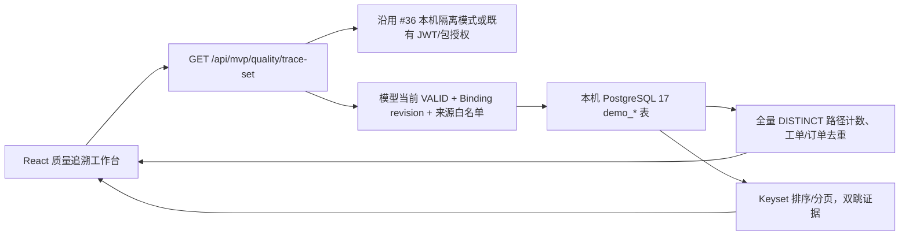

# M2 · 受影响工单与客户订单 ObjectSet 最小闭环｜功能与实现验收

> **状态**：#38 的实现/验收候选，依赖仍待合并的 #36（本机无 OIDC MVP）；只有 PR 合并到 main、真实 CI PASS 后才能记为主线功能。产品任务：[Issue #37](https://github.com/gitfortian/ontoforge/issues/37)。不覆盖唯一 [V1.3 总体架构](../本体产品总体功能与技术架构设计_v1.3.md)。

## 1. 用户真正得到什么

从“输入批次，仅可找到一条批次 → 工单 → 客户订单；超过一条即 409”升级为：

1. 打开 **工业质量追溯 · 精简 MVP**，先建立或打开 Native 三对象/两 LinkType，校验 VALID。
2. 选择本地 `public.demo_*` / `mvp_source_*` 的来源表与对应 10 个字段，预览真实样本，保存与模型 revision 绑定的 Mapping。
3. 输入批次 ID（例如 `LOT-900`）；可见它的质量状态、**去重的受影响工单数、去重的客户订单数、完整双跳路径总数**。
4. 每条关系路径展示批次、工单、订单和显示字段，以及两条 LinkType 对应的真实来源表/关联列。对重复的物理事实去重，不增加虚假的业务影响数。
5. 按工单 ID、客户订单 ID 固定顺序向前/向后翻页；可以辨认“来源断链但批次存在”和“批次本身不存在”。**每页只是一个部分，不会冒充全量结果**。

### 合成测试样例（PG17 Flyway V6）

| 批次 | 质量状态 | 物理来源关系 | 实际查询结果 |
| --- | --- | --- | --- |
| `LOT-900` | BLOCKED | 两条 batch→work 事实，四条 work→order 组合；含重复源事实 | **2 个工单 / 3 个去重订单 / 4 条路径**；分两页，每页 2 条 |
| `LOT-901` | PASSED | 工单外键 `JOB-MISSING` 不存在 | 批次存在、0 完整路径、`missingWorkRefs=1` |
| `LOT-903` | BLOCKED | 工单存在但订单外键 `SO-MISSING` 不存在 | 批次存在、0 完整路径、`missingOrderRefs=1` |
| `LOT-904` | 同一批次分别 BLOCKED/PASSED | 相互冲突来源事实 | 409 `SOURCE_FACT_CONFLICT`，拒绝假装单一质量状态 |

这些样本**不是工厂数据**。`demo_impact_lots/jobs` 中重复 ID 表示**多条关系事实**，对应逻辑对象相同；在当前固定 10 项 Mapping 下借助行级映射实现有限多路径演示。真实 MES/QMS 关系表、实体消歧和 LinkFact 存储需后续正式扩展，不能把该方式冒充通用设计。

## 2. 当前实现架构

- 不改变原有 `GET /api/mvp/quality/trace` 格式：一条路径照常返回，多个结果仍 409 而**不默默截断**；新页面改调用 `trace-set`，已有调用方可自行迁移。
- `TraceSet` 包含 `batchId`、`qualityStatus`、`boundRevision`、`sourceFingerprint`、`workOrderCount`、`orderCount`、`pathCount`、`missingWorkRefs`、`missingOrderRefs`、`paths[]`、`nextCursor` 和 `provenance`。
- `paths[]` 中每个对象含对象实例、类型、来源表；两条 Edge 含业务关系类型、起止对象 ID 和来源外键列。**并未持久化通用 ObjectSet/LinkFact**。
- `pageSize` 取 1–50；`nextCursor` 与批次 ID、当前模型 revision、映射 SHA-256 指纹绑定，超长/篡改/错批次/错版本游标拒绝。游标是分页定位符，不是身份凭据。
- 服务端使用本次请求内 `REPEATABLE_READ`、3 秒 PostgreSQL statement timeout、10,000 条关系路径预算。路径预算超出显式拒绝（409），不能伪装为完整结果。不同 HTTP 请求之间数据源变化不受该事务覆盖，页面和文档均提示。
- 固定场景通过 JDBC 预编译绑定批次 ID、游标、分页大小；来源表列必须通过已有标识符白名单与 `information_schema` 验证并引用。**不接受用户提交任意 SQL**。
- 新增 `V6__mvp_objectset_impact_sandbox.sql`，严格只加隔离测试表，不修改历史 V1–V5，也不改变用户已经创建的真实草稿、快照和绑定。

## 3. 安全、失败与专业边界

| 边界或失败 | 处理 | 产品含义 |
| --- | --- | --- |
| 无批次或非法批次输入 | 404 `BATCH_NOT_FOUND`；400 `INVALID_BATCH_ID` | 不把查询未命中说成“没有受影响订单” |
| 批次存在但无法双跳连通 | 200，`pathCount=0`，单独返回断链数量 | 不掩盖数据质量问题 |
| 同一批次状态冲突/订单展示字段冲突 | 409 `SOURCE_FACT_CONFLICT` | 不产生不可信的聚合与来源证据 |
| 模型变更后旧绑定 | 409 `BINDING_STALE` | 防止引用已经失效的模型定义 |
| 表列发生漂移 | 409 `BINDING_SCHEMA_DRIFT` | 必须重新审阅映射 |
| 无效游标、跨批次/跨绑定复用 | 400 `INVALID_TRACE_CURSOR` | 不串批次翻页 |
| 路径超过 10,000 | 409 `OBJECTSET_QUERY_BUDGET_EXCEEDED` | 控制本机测试扇出 |
| 多个 HTTP 请求之间来源变更 | 只保证单请求一致性，不保证跨页同一个历史快照 | 后续 Data Binding Version、来源水位和查询执行证据要补 |

**暂未实现**：全局任意类型 ObjectSet AST、动态 1:N/M:N 查询编译、实体身份合并、标准 LinkFact 索引、生产权限、真实 ERP/MES 接入、Agent 或 Action。不能称为“通用 ObjectSet 已交付”。

## 4. 验收与下一阶段

代码证据：
- `QualityMvpController.traceSet()`：真实 PostgreSQL 两跳、计数、路径分页和来源证据。
- `QualityImpactObjectSetTest`：真 Spring Boot HTTP/PG17；完整 2 工单/3 订单/4 路径、游标、非法入参、单路径兼容、断链/事实冲突。
- `test_real_mvp_quality.py`：Chromium 真实浏览器选择 `demo_impact_*`、预览/绑定、第一页/第二页/上一页以及来源证据。
- CI 跑原有 B0 JWT/Native 草稿/快照/质量追溯测试；#36 本机模式测试继续作为依赖基线。

**下一阶段优先级**：对接用户提供的**脱敏、经授权的实际制造数据**复核批次→工单→订单业务基数和实体/关系事实，再决定 ObjectSet 查询 AST/分页/溯源的通用化方案；不将账号/权限/审批/UI 登录再抬成核心 MVP 门槛。
