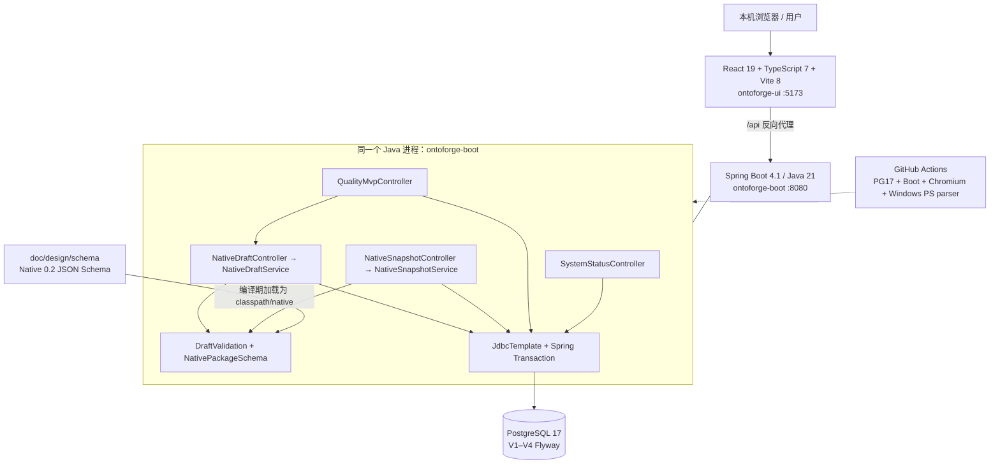
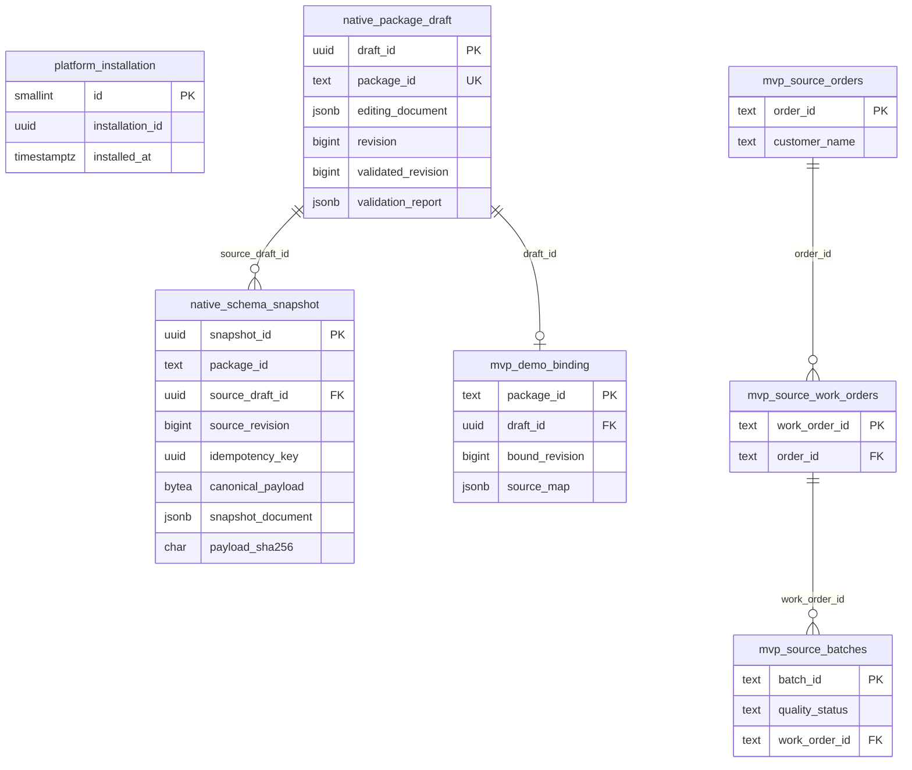
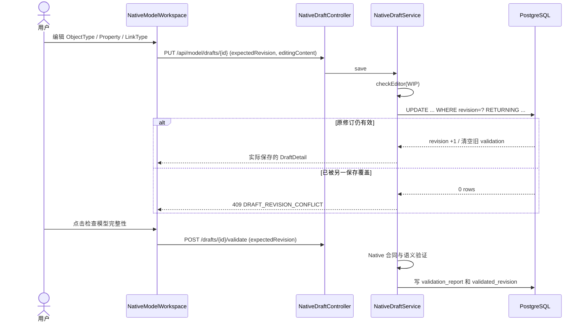
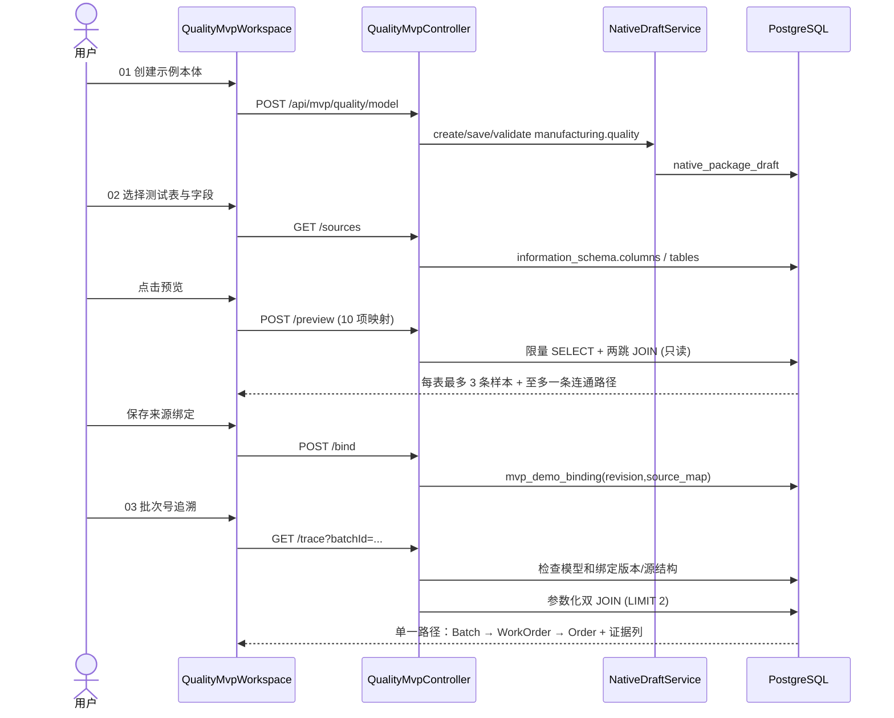

# OntoForge 砺元｜已实现技术与部署架构全景（AS-IS）

> **文档范围**：只描述 2026-10-17 已合并的 `main`（SHA `763fbfe792b45a84db8d3c2c423ca001a05682ed`）实际架构、代码调用链和数据结构。**不是**对原 [V1.3 产品总体架构](../本体产品总体功能与技术架构设计_v1.3.md) 的替代、不是未来模块已经上线的声明。
>
> **对照阅读**：[已实现功能全景](./OntoForge-AS-IS-已实现功能全景-20261017.md)（用户看到什么）｜[Native V0.2 设计合同](../design/核心本体元模型与Native-DSL-AST契约_v0.2.md)（约束）｜[PG 研究 POC](../../experiments/pg-runtime/README.md)（实验，不是产品）
>
> **版本分界**：PR #32/#33 已合并；PR #17（B0 OIDC/JWT，Draft）及 PR #34（CSV 导入，Ready for review）均**未合并**，不得列入本部署图或应用依赖。

> **主线演进更正（2026-10-17）**：本页原始 AS-IS 冻结于 `763fbfe...`（#17 合并前）；之后 #34 CSV 导入、#35 全景说明及 **#17 B0 OIDC/JWT 与 Flyway V5** 已合并 `main`。因此下方“当前 main 没有身份认证”“V1–V4”只代表**旧冻结基线**，不能再被引用为最新主线实际状态。#17 的 B0 代码虽已合并，仍未经企业 IdP/生产签收，且其缺少 OIDC 配置会阻塞无登录启动。本轮实施的 `mvp-local` 本机隔离 Profile **仅是当前 PR 的待合并候选**，详情见[实施决策](./MVP-核心优先与yak-ops认证复用决策-20261017.md)。未来 yak-ops HttpSession 复用还未移植实现。
>
## 1. 架构总览：实际是一个本机三层模块化单体

当前只有 **Maven Parent + `ontoforge-boot` 一个 Java 运行模块 + 独立 `ontoforge-ui` 前端工程 + 一套 PostgreSQL 17**。应用不存在单独的服务发现、微服务、消息队列、图数据库、独立 ObjectSet Runtime 或 Action Worker。



- **开发运行绑定**：后端缺省 `127.0.0.1:8080`，前端 Vite 缺省 `127.0.0.1:5173` 且代理 `/api → 127.0.0.1:8080`；本地 PostgreSQL 缺省 `127.0.0.1:5432/ontoforge`。
- **数据库是事实权威**：草稿、快照、绑定均存在 PostgreSQL；前端没有伪造的持久化成功和业务关联结果。
- **系统安全现状**：main **没有服务端用户身份认证与权限授权**，只能用于隔离开发/测试；`S0_HOST` 可配置，但严禁将未认证 API 绑定公网。Vite 本地开发服务器不是正式 Web 分发架构。
- **规划模块不等于运行模块**：`ontoforge-core/platform/dao/business/spi/plugins/dist` 在 V1.3/模块规划中属于未来候选，**当前 Maven Reactor 并未注册**这些模块。

## 2. 代码级职责和依赖边界

| 实际路径/组件 | 技术 | 职责与真实入口 | 当前边界 |
| --- | --- | --- | --- |
| 根 `pom.xml` | Maven Reactor，Java 21 | 统一版本与构建；仅 `ontoforge-boot` Java 子模块 | 未拆分 core/dao/platform |
| `ontoforge-boot` | Spring Boot 4.1.1、Web MVC、JDBC、Flyway | HTTP API、数据库事务与迁移 | 单体，不是生产 HA 服务 |
| `controller/SystemStatusController.java` | REST + JdbcTemplate | 获取 `platform_installation` 安装 UUID、服务/库状态 | 不采集全平台运行指标 |
| `controller/NativeDraftController.java` | REST | 草稿增删? **没有删除**；实际只创建/列表/读取/保存/校验 | 没有对外共享身份保护 |
| `model/NativeDraftService.java` | JdbcTemplate、revision CAS | 包草稿、WIP 存储、游标分页、校验修订管理 | 一包一个当前草稿 |
| `model/DraftValidation.java` | Java 验证规则 | editor v0.1 的安全 WIP 约束、完整性、Native 候选转换 | 不是企业全局语义推理 |
| `model/NativePackageSchema.java` | networknt JSON Schema validator | 将候选用共享的 Native V0.2 Schema 校验 | 仅在有限运行路径使用合同 |
| `controller/NativeSnapshotController.java` | REST | 本地快照冻结、按键/修订找回、历史、差异 | 无正式 Release |
| `model/NativeSnapshotService.java` | Spring `@Transactional`、JCS/SHA-256 | 冻结原子性、幂等、只读核验、结构 Diff | 非可信外部审计与发行 |
| `controller/QualityMvpController.java` | REST + JdbcTemplate | 固定制造三对象/两跳场景，本地来源映射/预览/追溯 | 不是通用查询引擎/数据源服务 |
| `ontoforge-ui/src/main.tsx` | React 路由（hash） | 本机系统页、建模页、质量追溯页入口 | 非 React Router/多应用门户 |
| `NativeModelWorkspace.tsx` | React 编辑状态 | ObjectType/Property/LinkType 表单、WIP/冲突处理 | 单人编辑体验，不是多人协同 |
| `NativeSnapshotWorkspace.tsx` | React 浏览/冻结 | 只读快照、同包版本比较、幂等键找回 | 不展示正式审批链 |
| `QualityMvpWorkspace.tsx` | React 请求与下拉选择 | 三步骤引导，真实表/字段选择、预览、保存绑定、批次追溯 | 固定 10 项配置，非通用 Studio Connector |
| `doc/design/schema/*.json` | JSON Schema + 测试 | Native Package、AST、ObjectSet 结果与执行证据合同 | 合同存在不代表执行器存在 |
| `experiments/pg-runtime/*` | Python/PG17/Mock ERP | ObjectSet/RLS/Outbox/竞态的可抛弃技术验证 | 不随生产 Spring Boot 启动 |

**没有实际存在的运行子系统**：Query Planner/Optimizer、ObjectIndex、LinkIndex、Binding Compiler、CDC Worker、Agent Gateway/MCP Server、Action Dispatcher、Policy Engine、Review/Release/Activation、企业身份目录。

## 3. 数据库架构：Flyway V1–V4 是不可篡改的历史



| Flyway 文件 | 真实表/约束 | 语义与重要保护 |
| --- | --- | --- |
| [V1__foundation.sql](../../ontoforge-boot/src/main/resources/db/migration/V1__foundation.sql) | `platform_installation` 单行 `installation_id` UUID | 确保安装身份在重启后仍是同一条事实 |
| [V2__native_package_drafts.sql](../../ontoforge-boot/src/main/resources/db/migration/V2__native_package_drafts.sql) | `native_package_draft`；`package_id UNIQUE`、revision、validated_revision/validation_report、JSONB 编辑文档 | 一个包一个草稿；保留部分完整 WIP，验证结果只针对具体 revision |
| [V3__native_schema_snapshot.sql](../../ontoforge-boot/src/main/resources/db/migration/V3__native_schema_snapshot.sql) | `native_schema_snapshot`；独立 snapshotId、来源修订、幂等键、规范化原始字节与摘要 | 同草稿修订只能冻结一次；同草稿幂等键唯一；DB trigger 禁止普通 UPDATE/DELETE |
| [V4__mvp_quality_trace_sandbox.sql](../../ontoforge-boot/src/main/resources/db/migration/V4__mvp_quality_trace_sandbox.sql) | `mvp_source_orders/work_orders/batches` 三表及两段 FK；`mvp_demo_binding` | 明确标记合成测试行；可配置字段角色绑定在 `source_map JSONB`；`bound_revision` 指向当前草稿修订 |

**实际关系**：来源测试表的 PK/FK 是 PostgreSQL 物理数据关系；Native `LinkType` 是模型定义；MVP 通过限定两跳 JOIN 返回临时事实。**并未创建一个独立、持久、可重建的通用 LinkFact 表**。不要把 `mvp_source_*` 称为通用 Ontology Index。

**V4 版本冲突的处理**：PR #17 的 B0 早期使用同名 V4；冲突候选已把 B0 权限迁移调整为**V5**，保留 main 的 V4。因为 #17 仍是 Draft，**当前 main 实际 Flyway 仍只有 V1–V4**；不能把 `b0_*` 表画进上方生产事实 ERD。

## 4. 模型数据结构、语义合同及版本链

### 4.1 编辑文档与 Native 候选是两个版本

- **Editor JSON v0.1.0**：`editorSchemaVersion`、`objectTypes[]`、`linkTypes[]`；ObjectType 有 `id/apiName/label/description/primaryKeyRef/properties`；Property 的值类型限于 `STRING/INTEGER/DECIMAL/BOOLEAN/DATETIME/ENUM`，有必填、检索、分类与枚举；LinkType 有 `sourceTypeRef/targetTypeRef/cardinality/evidenceRequired`。
- **Native Package candidate v0.2.0**：服务端从有效 editor 文档转换，使用 `doc/design/schema/ontology-package-v0.2.schema.json` 在 Java 中校验；尚未实现的 imports/bindings/linkBindings/objectSets/functions/rules/decisionStrategies/policies/actions 在**本地快照冻结**时必须为空。
- **持久版本不等价**：`revision` 是一次草稿写入的乐观锁版本；`snapshotId` 是一份只读本地结构快照；未来的 `releaseId` 是审批后的正式发行身份，目前没有。
- **绑定与模型定义分离**：质量 MVP 的 10 项表/字段配置保存于 `mvp_demo_binding.source_map`，与草稿 `draft_id + bound_revision` 绑定；它**不是完整 Native DSL/AST 的通用 Data Binding 资源**。

### 4.2 校验的两道不同门槛

1. **允许 WIP 保存**：`checkEditor` 对未知字段、结构大小和类型做安全编辑形状检查；即使未设置业务必填属性，也允许存草稿。
2. **允许冻结/绑定**：`DraftValidation.validate` 对当前内容返回 `INCOMPLETE`、`INVALID` 或 `VALID`，写回 `validated_revision`；只有当前 revision 的 VALID 才能进入本地快照，质量 MVP 还检查固定三个类型和两条关系端点。

代码中 editor 总大小上限 256 KiB、类型最多 50、LinkType 最多 200、单 ObjectType 属性最多 100、包属性总量最多 1000。上述是代码约束，不是工业可扩展性性能承诺。

### 4.3 模型草稿保存与版本竞争



- 并发保护位于 PostgreSQL 条件更新，并非浏览器自行比较。
- 每次成功保存清空旧 `validation_report/validated_revision`。`VALID` 不跨修订继承。
- 分页采用数据库排序 `(updated_at,draft_id)` 与 Base64 游标，不是前端一次全部加载。

## 5. 本地快照：原子冻结、完整性校验、差异

### 冻结时的真实顺序

1. 按 `draftId + idempotencyKey` 查重；存在则同 revision 原样返回，不会新建版本。
2. 在 PostgreSQL 事务内 `SELECT ... FOR UPDATE` 锁定草稿，并在取得锁后**再次**核对幂等键与 revision。
3. 检查当前草稿修订已被 `VALID` 验证，转换为 Native V0.2 Candidate 并用 Schema 校验。
4. 对 Candidate 执行 **RFC 8785 JCS** 得到规范 UTF-8 字节，计算 SHA-256。
5. 把 canonical_payload `BYTEA`、JSONB 镜像、摘要、来源 draft/revision、幂等 UUID 同事务写入 `native_schema_snapshot`。
6. 读取快照时再次核验字节、摘要、JSONB 镜像、Schema 与包身份。任何不一致直接拒绝，把损坏数据假装为正确结果是不允许的。
7. V3 trigger 拒绝普通应用会话更新/删除已冻结行；**数据库超级管理员仍能操作 DDL/trigger，这不是不可篡改可信审计**。

### 快照差异如何运作

`NativeSnapshotService.diff(from,to)` 仅比较**同一 packageId** 的两份快照；对 ObjectType/Property/LinkType 按稳定 ID 对齐，对字段/主键/基数/证据要求生成 `ADDED/REMOVED/MODIFIED` 变化和风险等级。`POTENTIALLY_BREAKING` 表示需要复核，**不是下游消费者验证通过或失败**。

### 错误与恢复

- 当前修订未 VALID：`409 VALIDATION_NOT_CURRENT`。
- 已有另一幂等键为同 revision 冻结：`409 SNAPSHOT_REVISION_ALREADY_FROZEN`。
- 重用同键指向不同 revision：`409 IDEMPOTENCY_KEY_REUSED`。
- 响应未知：**使用原 idempotencyKey 重查**，不能随机新建键制造歧义。
- 本地 PostgreSQL 中断：需要先恢复连接并核对原 draft/snapshot；没有多机故障切换机制。

## 6. 质量追溯实现：不是数据库表的静态 Mock



### 白名单映射与 SQL 边界

| 角色 | 映射字段 | 示例默认来源 |
| --- | --- | --- |
| 批次 | `batchTable, batchId, batchStatus, batchWorkOrder` | `mvp_source_batches(batch_id, quality_status, work_order_id)` |
| 工单 | `workTable, workId, workOrder` | `mvp_source_work_orders(work_order_id, order_id)` |
| 订单 | `orderTable, orderId, orderName` | `mvp_source_orders(order_id, customer_name)` |

- 固定 10 项，不接受任意 SQL；表名只允许当前本地 `public` 中匹配 `^(demo_|mvp_source_)` 的白名单表，标识符限正则、通过 `information_schema` 验证列并用双引号转义；批次号使用 JDBC 参数而不是 SQL 拼接。
- 来源字段只列举 `text/character varying/character/uuid/integer/bigint` 等可显示的基本类型；三个角色必须选择不同的表。
- `POST /preview` 是无持久化预览，每表 `LIMIT 3`、关系 `LIMIT 1`。未找到样本**不能推断全表都无关系**。
- `POST /bind` 验证当前模型 revision 和 VALID，保存 `source_map` 到 `mvp_demo_binding`。`GET /trace` 再核对绑定版本/结构；模型变更或表字段缺失会拒绝，而不是静默使用旧映射。
- 双 JOIN 返回 `Fact` 列表（对象类型 ID、实例 ID、显示标签、来源表）及 `Edge` 列表（LinkType ID、from/to、来源外键列），还有来源类别标记。**它没有快照一致性时间、记录级完整血缘或证据签名**。
- 当前查询只支持单路径；命中多于一条时 `409 AMBIGUOUS_RELATIONSHIP`，这是保证不谎称完整结果的保护，也暴露下一阶段“一批次影响多订单”能力缺口。
- 映射查询与运行 SQL 均存在同一个 Spring Boot 进程内；未部署 CDC、分布式执行计划、物化投影或异步数据管道。

## 7. 接口与失败契约

REST 接口完整列表见[功能全景第 4 节](./OntoForge-AS-IS-已实现功能全景-20261017.md)。当前主要安全/失败保护来自输入检查、数据库约束、乐观锁和业务状态核验：

| HTTP / 错误类 | 触发原因 | 应采取的动作 |
| --- | --- | --- |
| 400 `MALFORMED_REQUEST`、`INVALID_BATCH_ID` | 请求形状/UUID/批次格式错误 | 纠正输入 |
| 404 `DRAFT_NOT_FOUND`、`SNAPSHOT_NOT_FOUND`、`BATCH_NOT_FOUND` | 无对应记录 | 核对 ID/目标测试库 |
| 409 `DRAFT_REVISION_CONFLICT` | 草稿已被其他保存改写 | 保留本地编辑、读取服务器修订 |
| 409 `VALIDATION_NOT_CURRENT`、`BINDING_STALE` | 冻结或追溯使用旧修订 | 保存并重新校验、重新绑定 |
| 409 `BINDING_SCHEMA_DRIFT`、`AMBIGUOUS_RELATIONSHIP` | 表字段已变化、或不满足单路径假设 | 检查测试数据与关联模型，不截断输出 |
| 422 `EDITOR_DOCUMENT_INVALID`、`SOURCE_SCHEMA_MISMATCH` | 非法模型形状、表/列或白名单限制 | 逐条修正配置 |
| 503 `PERSISTENCE_UNAVAILABLE` | 数据库不可用 | 恢复 PG 后核对，不能认定写入成功 |
| 500 `SNAPSHOT_INTEGRITY_FAILURE` | 快照字节/摘要/镜像不一致 | 阻止展示并查明损坏原因 |

当前 **无登录令牌，也无可信多租户鉴权**；不能把这些输入/并发保护说成安全架构已经交付。

## 8. 开发运行与部署的真实形态

### Windows 11 / 本机 PostgreSQL 默认路径

| 配置 | 当前默认 | 作用 |
| --- | --- | --- |
| Java | 21 | Maven Spring Boot |
| Node | 22（>=22.12 且 <23） | React/Vite |
| PostgreSQL | 17（CI 与示例） | 核心持久库 |
| `DB_URL` | `jdbc:postgresql://127.0.0.1:5432/ontoforge` | 默认本机 PG |
| `DB_USERNAME` | `postgres` | PG 用户 |
| `DB_PASSWORD` | **必须环境注入** | 不能写入 Git |
| `S0_HOST` / `PORT` | `127.0.0.1` / `8080` | 后端监听 |
| Vite | `127.0.0.1:5173` | 前端本地服务 |

运行入口：

```powershell
$env:DB_URL = 'jdbc:postgresql://127.0.0.1:5432/ontoforge'
$env:DB_USERNAME = 'postgres'
$env:DB_PASSWORD = '<通过安全方式设置真实本机密码>'
mvn -pl ontoforge-boot spring-boot:run

# 另开窗口
cd ontoforge-ui
npm ci
npm run dev
```

上述片段中的 `<...>` 是说明占位符而非可直接执行的真实密码；请使用交互式安全读取，勿将凭据写进脚本或文档。详情遵循 [Windows 启动手册](./S0-Windows11-本机PostgreSQL-启动与验收.md)。

**Compose**：根 `compose.yaml` 提供的是另一个可选本机 Docker PG 开发路径（测试库名 `ontology`），不可同时当成 Windows 默认 `ontoforge` 库而混淆数据。

**生产部署状况**：仓库没有经过签收的企业 IdP、发布包、K8s/HA、备份恢复、审计策略、性能容量或真实工业接口适配。不可使用该开发配置上线公网/连接真实生产库。

## 9. 测试与研发治理架构

```text
Pull Request / main push
  └─ .github/workflows/quality-gate.yml
       ├─ Select Quality Scope → 依据真实 diff 选择需执行检查
       ├─ Documentation and Governance Checks
       ├─ Native V0.2 Schema Contract Tests
       ├─ S0 PostgreSQL Flyway Integration（隔离 PG17，Java test）
       ├─ React TypeScript Production Build
       ├─ Real PG17 + API + React Chromium Golden Story
       ├─ Research PostgreSQL ObjectSet Outbox Smoke（POC，非产品）
       └─ Required Quality Gate（唯一固定汇总状态）
```

- **后端单测/集成**：`ontoforge-boot/src/test/java/` 包含 Foundation、Draft、Snapshot、Native Schema、Flyway 升级与隔离数据库保护测试。
- **真实端到端**：`ontoforge-ui/e2e/test_real_native_draft.py`、`test_real_native_snapshot.py`、`test_real_mvp_quality.py` 运行在真 Spring Boot + PG17 + Chromium，而不是 HTML Mock。
- **脚本实测**：`scripts/verify-s0.ps1`、`verify-objecttype.ps1`、`verify-linktype.ps1`、`verify-snapshot.ps1`；可对新建隔离草稿 Exercise，再在**真实后端重启**后 Recheck。
- **Windows 与 Linux 区别**：在 Linux PowerShell 7 执行功能脚本 + Windows PowerShell 5.1 语法解析，并不代表用户现有 Windows 11 安装上的 PostgreSQL/Edge/UAT 已通过。
- **选择性质量门禁**：工作流路径选择器见 `scripts/ci/quality_ci.py`；被跳过的检查应报告为 NOT SELECTED，不得称为测试成功。GitHub Ruleset/branch protection 的实际配置与工作流成功也非同一事实。

代表性已合并用户故事证据：[PR #32](https://github.com/gitfortian/ontoforge/pull/32)、[PR #33](https://github.com/gitfortian/ontoforge/pull/33)；后者 [真实 CI](https://github.com/gitfortian/ontoforge/actions/runs/39007977105)。这些成功仅说明对应提交的隔离环境自动化测试通过。

## 10. 和 V1.3 理想架构的真实差距

| 设计目标（V1.3） | 当前运行实现 | 中间缺少的工程层 |
| --- | --- | --- |
| Ontology Language | **有限 Native editor/valid candidate + JSON Schema** | 完整语言生命周期、跨包引用、类型演进与编译 |
| Data Binding | **单本机 PG、三表七字段角色、固定包的版本受限映射** | 真 Connector、实体身份/冲突处理、绑定版本和来源可信目录 |
| ObjectSet | **单场景只读两跳 SQL JOIN** | 可组合查询 AST 解释/编译、任意关系遍历、分页排序、对象关系读模型与授权 |
| Agent Context | 未实现 | 只读 API/SDK/MCP、证据/时效/权限上下文 |
| Functions/Decision | 未实现（仅 DSL 研究合同） | 可重放确定性函数和策略执行器 |
| Governed Action | 未实现（只有独立研究 POC） | Policy/Approval/Outbox、外部接收与效果验证 |
| Review/Release/Activation | 未实现（本地快照不是正式发行） | ChangeSet、可信审批人、ReleaseManifest、激活/回退 |
| Enterprise Security | main 未实现，#17 Draft 候选 | IdP、业务包/对象/字段授权、撤权、安全审计 |
| Production Operations | 本机状态接口 + CI | 监控、备份、升级与性能容量、安全交付 |

**推荐演进纪律**：先用脱敏测试数据确认当前单条追溯可复现，并审视“一批多订单”的真实数据模型；再做**最小 ObjectSet 结果集**，而不是按概念清单一口气生成十几个空模块。每个 PR 必须注明新增用户可观察功能、相关 API/数据库状态、关键负例、真实测试证据和未完成边界。

## 11. 审查范围、风险登记与维护机制

| ID | 当前风险或约束 | 影响 | 后续可验证门槛 |
| --- | --- | --- | --- |
| AR-01 | main 无认证/授权 | 对公网开放会造成模型/测试数据泄露或修改 | 独立安全签收 B0 或其他经过评审的正式身份方案 |
| AR-02 | 固定包/固定角色映射 | 无法任意对象类型绑定/跨域扩展 | 第二个完全不同的业务场景也可复用绑定 |
| AR-03 | 固定单路径查询 | 一批次多订单可能 409 | 返回完整可解释的多结果集合并分页 |
| AR-04 | source_map 未版本化为独立 BindingVersion | 无法复建跨时点业务事实 | 来源修订、查询执行证据与漂移管理 |
| AR-05 | 自动样本只读且限量 | 无全量质量覆盖率 | 可量化、可解释的关联覆盖/断链报告 |
| AR-06 | 无工业源身份、访问与连接管理 | 不能声称已接 MES/ERP | 经过授权的脱敏工业测试源接入与来源审计 |
| AR-07 | Snapshot 只能本地用途 | 不能给外部消费者承诺发布稳定性 | 审核、Release、Activation、回退独立可证明 |
| AR-08 | 无用户现有 Windows 11 现场 UAT | Linux CI 不等于实际用户体验 | 本机安装、真实重启、持久记录、交互与异常核验 |

**维护约束**：本 AS-IS 只随实现代码变更更新 SHA 与证据。未来 #17/#34 合并后须另行改状态并验证 API/迁移。严禁把这份文件演变成第二份“未来架构 V1.4”，相关决策统一回到 V1.3/OFIP。

---

## 附录 A：快速定位表

- [用户功能及成熟度](./OntoForge-AS-IS-已实现功能全景-20261017.md)
- [总体架构规划 V1.3](../本体产品总体功能与技术架构设计_v1.3.md)
- [Native DSL/AST 合同](../design/核心本体元模型与Native-DSL-AST契约_v0.2.md)
- [后端入口](../../ontoforge-boot/src/main/java/io/ontoforge/boot/OntoForgeApplication.java)
- [草稿服务](../../ontoforge-boot/src/main/java/io/ontoforge/boot/model/NativeDraftService.java)
- [快照服务](../../ontoforge-boot/src/main/java/io/ontoforge/boot/model/NativeSnapshotService.java)
- [质量追溯服务](../../ontoforge-boot/src/main/java/io/ontoforge/boot/controller/QualityMvpController.java)
- [数据库版本目录](../../ontoforge-boot/src/main/resources/db/migration/)
- [系统首页和菜单](../../ontoforge-ui/src/main.tsx)
- [质量门禁](../../.github/workflows/quality-gate.yml)
- [实验与真实产品边界](../../experiments/pg-runtime/README.md)
