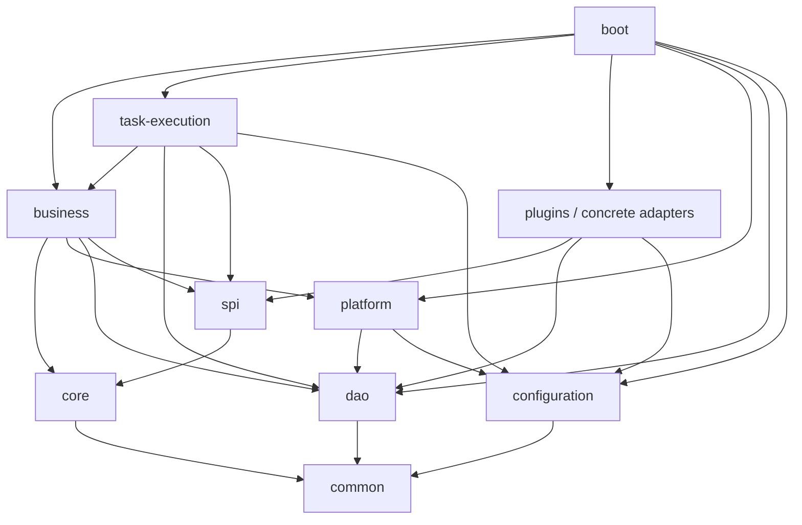

# OntoForge · 砺元｜完整工程模块结构规划与命名规范

> **状态：完整工程规划 + 2026-10-19 模块化实施说明。** 总体设计仍为候选；第 2 节记录真实代码，其余目标目录与功能矩阵不代表能力已经全部实现。
>
> 产品与技术总纲仍只有 [总体架构 V1.3](../本体产品总体功能与技术架构设计_v1.3.md)，机器合同仍以 [Native DSL/AST V0.2](../design/核心本体元模型与Native-DSL-AST契约_v0.2.md) 为准。本文件负责将完整功能映射到工程目录、模块职责、依赖和实施顺序，不新增第二套总体架构或 Schema。
>
> 沿用原 `S0-工程模块规划与命名规范.md` 路径以保持已有链接有效，内容覆盖 S0 至 P4。**完整规划先行，实际工程按用户闭环创建；不得据此一次性生成空 POM、空接口或伪数据页面。**

## 1. 参考依据与适配范围

严格参考 [Yak Ops](https://github.com/weifuwan/yak-ops) 的实际源码与 POM，而不是按 README 的能力介绍推测模块。核验快照为 `main@85338827bdbb745eaa6a017031640674a298a4f9`，提交时间为 2026-10-15 13:04:09（UTC+8），核验日期为 2026-10-17。详细子模块与直接依赖见 [固定版本研究记录](../research/2026-10-17-Yak-Ops-模块结构与依赖核验.md)。

参考要点来自 [根 POM](https://github.com/weifuwan/yak-ops/blob/85338827bdbb745eaa6a017031640674a298a4f9/pom.xml)、[Business POM](https://github.com/weifuwan/yak-ops/blob/85338827bdbb745eaa6a017031640674a298a4f9/yak-ops-business/pom.xml)、[Platform POM](https://github.com/weifuwan/yak-ops/blob/85338827bdbb745eaa6a017031640674a298a4f9/yak-ops-platform/pom.xml) 和 [UI 工程](https://github.com/weifuwan/yak-ops/tree/85338827bdbb745eaa6a017031640674a298a4f9/yak-ops-ui)：统一前缀、Parent/Reactor、职责分层、业务聚合、插件合同与实现分离、独立组装和分发。

该快照根 Reactor 有 21 个直接条目，包括嵌套路径；`yak-flow` 与 `yak-ops-plugins` 本身是目录容器，不能推定都有聚合 POM。源码中的数据同步、调度、CDC 和 Flow 能力不能直接视为本体产品所需能力。

本规划的取舍：

- **沿用工程骨架**：`common / configuration / dao / platform / core / spi / plugins / business / task-execution / boot / ui / dist / bom / test-utils / e2e` 的职责命名。
- **按本体产品替换业务内容**：Native Model、Registry、Binding、ObjectSet、Rule/Function/Decision、Agent、Action、语义协同构成本项目业务内容。
- **明确适配差异**：OntoForge Core 包含本体领域与编译规则；SPI 承载本体扩展合同；具体插件由 Boot 选择组装。Yak Ops Core 实际为数据流合同，SPI 主要提供通用发现器，插件合同另有各自 API 工程；不能把相同后缀解释为业务职责相同。
- **保留技术选择**：Java 21、Spring Boot、PostgreSQL、React/TypeScript；不因参考项目使用某数据库、ORM、调度器或前端 Workspace 就自动引入。
- **保留单前端工程**：`ontoforge-ui` 直接作为 npm 根。Yak Ops UI 是单 web 应用加共享组件的 Workspace；本项目出现第二应用或确有共享包需求后再评估，不恢复根 `apps/api`、`apps/web`、`infra` 临时结构。

主要结构对应关系如下；“适配”是本项目选择，并非源项目事实：

| Yak Ops 固定快照 | OntoForge 目标 | 沿用/适配 |
|---|---|---|
| Parent、BOM、Common、Configuration | 同职责的 `ontoforge-*` | 沿用分层；Common 收窄为真实复用，BOM 按复杂度提取 |
| Platform → DAO → Common | Platform → DAO → Common | 沿用单向持久化分层；改用现有 PostgreSQL 技术栈 |
| Core → Configuration；数据流合同 | Core → Common；Native 领域合同 | 适配：Core 不读运行配置，预算等输入由调用方传入 |
| 通用 SPI + 各插件 `*-api` | SPI 中按 connector/query/function/action 等分包 | 适配：初期统一合同 JAR；依赖隔离确有收益时提取 `ontoforge-plugin-<kind>-api`，替换原定义而非维护两份 |
| Business 聚合 POM + datasource/task/schedule 子模块 | Business JAR 内完整本体用例包，按条件拆子模块 | 沿用业务所有权；不照搬数据平台的领域划分 |
| 具体插件、Task Execution、Boot | 本体 Adapter、持久任务执行、Boot | 沿用接口/执行/组装分离；具体插件只由组装层引入 |
| YakFlow Runtime/Connectors/CDC | 首期无同名 Flow 工程 | 数据接入与可靠任务按本体需求实现，不复制数据处理引擎 |
| UI Maven 占位 + npm Workspace | 独立 npm 根，无 UI POM | 前端独立构建，正式 Dist 消费构建产物 |
| Test Utils、后端 E2E、UI Playwright、Dist | 本地测试夹具、跨进程/浏览器验收、正式分发 | 沿用验证层次，实际项目随功能创建 |

## 2. 当前实现与本轮工程规范化

| 层面 | 当前真实实现 | 仍待交付 |
|---|---|---|
| Parent | `io.ontoforge:ontoforge:0.1.0-SNAPSHOT`；注册 Common、Configuration、Core、DAO、Platform、Business、Boot 七个 JAR | SPI/Plugins/Task Execution、独立 BOM/正式分发等目标工程 |
| Boot | HTTP/安全过滤器、配置与显式模块 `@Import` 组装 | 保持唯一默认应用入口 |
| Common / Configuration | 跨模块 SHA-256；原有本机数据库/来源环境校验 | 无实际消费者的工具与配置平台不提前建设 |
| Core | Native 编辑校验、V0.2 Schema 适配、RFC 8785/JCS 字节与摘要 | 完整 AST Compiler、受治理 Registry、正式 Release/Activation |
| DAO | Draft/Snapshot/Binding/Identity/质量查询、有预算/截止时限的 PG 来源读取；唯一 Flyway V1–V7 | 外部 ERP 写回、生产索引/Outbox |
| Platform | 既有 JWT 包权限、本机 MVP 模式、可信列表范围、真实安装状态 | 企业权限产品和生产安全签收；认证路线本轮不变 |
| Business | 草稿/快照/类型解析、M5 Binding、M6 对象读取、质量追溯、local-query-v1 查询/冻结分页/聚合用例与事务 | 通用查询规划、Function/Decision/Action 等完整能力 |
| UI | 单 npm 根；`src/app` 路由组装、`src/features` 实际页面、`src/shared/api` 既有身份/请求 | 不创建未来阶段空页面 |
| 验证 | 既有真实 PG/HTTP/安全负例、UI 构建与浏览器脚本；新增模块依赖/迁移所有权检查；main 已有稳定 Required Gate | 本轮实际执行结果与未执行项分别报告 |

本轮最初基于 main `4cc7359` 重构，提交 PR 前合入 main `58636a8`（含 M7 通用 ObjectSet 查询与 M8 R1 设计决定），并将新增实现归入相应模块。重构，保留 HTTP/JSON、模型与绑定格式、错误码、CAS/快照幂等、来源限制和认证分支。`mvp-local` 仍需显式开启，默认 JWT/OIDC 路径继续拒绝未授权访问；本地快照不升级为正式发布。M7 已交付 local-query-v1 的有界查询、冻结分页与聚合切片；更广泛的查询规划和企业生产能力仍按后续阶段交付。

### 2.1 当前启动与验收

在仓库根设置既有 DB/Profile/OIDC/来源参数，执行 `./scripts/run-local.ps1`。脚本构建 `mvn -B -pl ontoforge-boot -am -DskipTests package`，再运行 Boot jar，不依赖本机预装内部 artifact；已有构建可加 `-SkipBuild`。直接使用 `spring-boot:run` 时，先执行 `mvn -pl ontoforge-boot -am -DskipTests install`。

后端测试继续使用独立 loopback `ontoforge_test_*`、`TEST_DB_*` 和显式故障注入开关，执行 `mvn -pl ontoforge-boot -am clean verify`。UI 使用 Node 22、`npm ci`/`npm run build`；模块边界与 CI 选择执行 `python -B -m unittest discover -s scripts/ci -p 'test_*.py' -v`，另保留文档/Native 回归和实际浏览器验收。hash 路由不因物理文件名改变。

Flyway 七份 SQL 仅改变资源所属模块，版本、文件名和内容保持一致。原库直接校验，不能 repair、重建或再次初始化 UUID。Native Schema 资源由 Core 打包，继续读取唯一 `doc/design/schema/ontology-package-v0.2.schema.json`。

### 2.2 本轮实际验证记录（2026-10-19）

验证对象为合入 main `58636a8` 后的 `codex/normalize-module-structure` 工作区变更，使用 Java 21、Node 22.23.1 和独立 loopback PostgreSQL 18.6 临时集群；未使用或改写开发数据库。

| 检查 | 实际结果 |
|---|---|
| Maven Reactor `clean verify` | 74 项测试通过，0 失败、0 错误、0 跳过；包含真实 PG、HTTP、权限负例与并发用例 |
| 跨模块 Surefire 证据门禁 | 通过，包含迁出的 Core、Configuration、Business 测试 |
| CI 范围/模块边界检查 | 22 项通过 |
| 文档治理与链接检查 / Native V0.2 合同 | 分别 21 项 / 52 项通过；local-query-v1 合同另有 7 项通过 |
| UI `npm ci`、`npm run build`、依赖审计 | 构建通过，审计 0 漏洞 |
| Playwright 真实浏览器 | 31 项通过；真实 JWT 测试身份、Boot、PG 与 Vite，覆盖登录/权限、草稿/快照、绑定、对象读取、质量追溯与 M7 查询/冻结分页/聚合 |
| 新启动脚本实际重启 | `run-local.ps1 -SkipBuild` 重启后，安装 UUID、绑定两版摘要、快照 ID/摘要与重启前一致 |
| M7 权限与游标失效 | 实际撤销包授权后返回 403；恢复授权后旧游标仍为 410。另一个重启前有效的游标在实际重启后返回 410，重新执行同一查询的摘要保持一致 |
| 历史迁移完整性 | DAO 内 V1–V7 与基线 Boot 资源逐文件 Git blob 一致 |
| 工作区检查 | `git diff --check` 通过；PowerShell 启动脚本语法解析通过 |

本机 Oracle JDK 21.0.12 在默认临时目录执行 `Selector.open()` 可独立复现失败；本次测试进程通过 `JAVA_TOOL_OPTIONS=-Djdk.net.unixdomain.tmpdir=D:/tianxy/code/ontoforge` 指定可用目录后完成验证，未改变应用的默认 JVM 配置。GitHub Actions 与 CI 使用的 PostgreSQL 17 本轮未实际运行；上述本机结果不替代生产安全、真实系统接入或产品签收。

## 3. 完整目标目录

下列树是**完整目标目录**，当前真实子集见第 2 节；例如 Core 仅 compiler 已有实际代码，其他模块也只创建现有功能使用的包。下列名称先是 Java 包，不自动成为 Maven 子模块。

```text
ontoforge/
├── pom.xml                         # Parent/Reactor：仅登记真实模块
├── ontoforge-bom/                   # 外部依赖版本约束，POM，按需提取
├── ontoforge-common/                # 最小技术公共类型
├── ontoforge-configuration/         # 类型化配置、校验、秘密引用
├── ontoforge-dao/                   # PostgreSQL 持久化、迁移、受控 SQL
│   └── src/main/
│       ├── java/io/ontoforge/dao/
│       │   ├── platform/ model/ governance/ connection/
│       │   ├── object/ query/ knowledge/ decision/ action/
│       │   └── outbox/ evidence/
│       └── resources/db/migration/  # 全产品唯一 Flyway 版本序列
├── ontoforge-platform/             # 身份、Workspace、授权、证据、运维基础
│   └── src/main/java/io/ontoforge/platform/
│       └── identity/ workspace/ policy/ evidence/ operations/
├── ontoforge-core/                 # 本体领域语义与确定性计算规则
│   └── src/main/java/io/ontoforge/core/
│       ├── model/ compiler/ registry/ binding/ identity/
│       ├── object/ query/ rule/ function/ decision/ action/
│       └── knowledge/ collaboration/ quality/ context/ standard/
├── ontoforge-spi/                   # 可替换扩展 Interface，按实际需求增加
│   └── src/main/java/io/ontoforge/spi/
│       └── connector/ query/ function/ action/ knowledge/ ai/ standard/
├── ontoforge-plugins/               # 插件目录容器，先不要求自身拥有 POM
│   ├── connectors/                 # 接源、Schema、Checkpoint、回执能力
│   │   └── jdbc/ qms/ mes/ erp/ plm/ eam/ historian/ document/
│   ├── query/                      # PostgreSQL 默认；search/graph 按 POC 引入
│   ├── functions/                  # 经审定的确定性函数实现
│   ├── actions/                    # 远端命令、回执查询和结果核验 Adapter
│   ├── knowledge/                  # 文件解析、证据抽取；可选搜索/Embedding
│   ├── ai/                         # 可选模型供应商 Adapter
│   └── standards/                  # 可选 RDF/OWL/SHACL 与标准文档 Profile
├── ontoforge-business/              # 面向用户的用例与事务编排
│   └── src/main/java/io/ontoforge/business/
│       ├── model/ governance/ connection/ object/ query/
│       ├── knowledge/ decision/ agent/ action/ collaboration/
│       └── ecosystem/ operations/
├── ontoforge-task-execution/        # 索引、导入、Action、对账等持久任务 Worker
│   └── src/main/java/io/ontoforge/execution/
│       └── job/ lease/ indexing/ dispatch/ reconciliation/
├── ontoforge-boot/                  # 唯一默认 Spring Boot 入口与实际组装
│   └── src/main/java/io/ontoforge/boot/
│       └── configuration/ controller/ protocol/
├── ontoforge-ui/                    # 已存在；独立 npm/Vite 工程
│   └── src/                        # 目标分解见第 7 节
├── ontoforge-test-utils/            # test-scope 公共夹具，真实复用时再建
├── ontoforge-e2e/                   # 黄金故事/浏览器/跨进程验收
├── ontoforge-dist/                  # 发行组装、启动、配置、部署与升级
├── ontology-packages/               # 版本化本体内容资产，非 Java Reactor
│   └── core/ manufacturing-foundation/ domains/ extensions/ profiles/
├── doc/                            # 沿用 design/research/implementation
├── experiments/pg-runtime/          # 研究 POC，不直接当作生产实现
├── scripts/                        # 现有验收及未来工程脚本
└── .github/workflows/               # 按阶段扩展真实检查
```

插件树中的 `qms`、`mes`、`erp` 等是能力分类；实际 artifact 按目标系统、协议及兼容版本命名，如 `ontoforge-plugin-connector-<system>`。不同厂商系统不能假设为同一协议，也不一开始把树中每一项都做成独立工程。

## 4. 后端模块职责、Interface 与创建条件

统一 GroupId `io.ontoforge`、artifact 前缀 `ontoforge-`、Java 包前缀 `io.ontoforge`。目录用连字符，Java 包用小写分段；`task-execution` 对应 `io.ontoforge.execution`。

| 模块 | 拥有的 Implementation / 对外 Interface | 首次创建条件 |
|---|---|---|
| `ontoforge-bom` | 第三方依赖版本；不是运行时库，不维护业务模型版本 | 版本管理确需独立复用；此前继续用根 Parent/BOM |
| `ontoforge-common` | 已跨模块复用的错误码、分页/追踪等最小技术类型 | 至少两个真实模块需要；不放所有 DTO/领域对象 |
| `ontoforge-configuration` | 数据库、预算、任务、插件等类型化配置及启动校验 | 配置跨模块共享；不存凭证值、不决定授权 |
| `ontoforge-dao` | SQL、持久化记录、Repository 查询、索引、Outbox 原子操作、Flyway | 首个真实持久化需求超出 Boot 底座（S0 身份/空间或 P0 模型）；领域规则由 Core/Business 决定 |
| `ontoforge-platform` | 主体与空间、PDP/PEP、分类/撤权、证据与运维基础 Interface | 多人或接真实数据前；认证/隔离 Gate 先于该用途上线 |
| `ontoforge-core` | Native 模型、编译/引用/兼容、状态机、查询/决策语义 | P0-A 首个真实建模闭环；不依赖数据库或具体源 |
| `ontoforge-spi` | Connector、QueryExecutor、Function、ActionExecutor、标准/知识/AI 扩展 Interface | 有可替换实现或插件兼容需求；不预造万能接口 |
| `ontoforge-plugins` | SPI 的具体 Adapter：源方言、协议、错误、幂等/回执/核验 | P1 首个实际源；P3 写回与读源权限分别开通 |
| `ontoforge-business` | 授权用例、事务、核心规则调用、DAO 转换、插件选择及证据编排 | P0 首个跨校验/保存/读取用例；不实例化具体插件 |
| `ontoforge-task-execution` | 持久任务领取、Lease/ClaimToken、取消/重试、派单、对账 Worker | P1 跨请求索引或 P3 可靠执行；不预造通用工作流平台 |
| `ontoforge-boot` | Controller、协议 Adapter、配置导入、插件/Worker 组装、健康状态 | 已存在；领域实现随相应模块出现逐步迁出 |
| `ontoforge-ui` | 八功能域工作台与交互；消费服务端合同 | 已存在；只开放实际可操作功能 |
| `ontoforge-test-utils` | 跨模块测试工厂、PG/Mock 源夹具、权限与故障工具 | 两个测试集合确有复用；生产代码不得依赖 |
| `ontoforge-e2e` | 黄金故事、真实浏览器/数据库及跨进程故障验收 | P0 完整建模/发布路径可操作；不替代局部测试 |
| `ontoforge-dist` | 应用/前端/插件/模型包分发、配置、升级、恢复入口 | 首次面向企业环境交付；文档版本不等于发行版本 |

### 4.1 Core 内部完整领域分解

| 包 | 拥有的领域事实与 Interface | 明确限制 |
|---|---|---|
| `model` | Package、ObjectType、Property、LinkType、稳定身份、Ref、依赖坐标；各 Native 资产声明 | 类型定义不等于实例；不强制 IRI |
| `compiler` | Schema/类型/Ref 校验、Typed AST、规范化、SourceMap、真实 Digest、锁解析 | 结构有效不等于可信发布；页面不充当发布权威 |
| `registry` | Draft/Release/Activation、版本解析、兼容与依赖影响规则 | 模型 Registry 与 Capability Registry 分开；发布不自动激活 Binding/Action |
| `binding` | Field/Link/Event Mapping、属性级 Authority、SourceSchemaVersion、Checkpoint | SourceRef 是连接引用；凭证不进入分发包 |
| `identity` | SOURCE_KEY、APPROVED_CROSS_SOURCE、候选/批准/冲突/撤销语义 | 业务对象身份区别于 Platform 用户主体身份 |
| `object` | SourceFact、Object/Link Projection、OperationalEdit、EffectiveObject、时间/冲突 | 读模型可重建；LinkType 不能自动产生 LinkFact |
| `query` | Typed ObjectSet、逻辑计划、去重/聚合、预算、分页、Explain、质量合同 | 不收 raw SQL 或自填授权；不绑定唯一物理引擎 |
| `rule / function / decision` | 规则、函数签名/实现摘要、READ_ONLY/EDIT_PLAN、策略与确定性输出 | EDIT_PLAN 只产 ChangeSet；决策不能直接写外部系统 |
| `action` | Preview、Risk、EffectScope、审批版本锁、Attempt/Receipt/Outcome 状态机 | 回执与业务成功分开；UNKNOWN 不转成假失败/假成功 |
| `knowledge` | 文档/片段引用、版本与来源证据、分析/诊断/影响路径 | 检索结果不能自动当作受信业务事实 |
| `collaboration` | Term/Concept、上下文/共识、AlignmentAssertion、ReviewDecision | 同名不自动等价；候选对齐不直接影响权威运行时 |
| `quality` | 结构/引用/依赖/兼容、语义冲突与质量报告规则 | 与实时来源 Completeness 分开；SHACL 为可选 Profile |
| `context` | Schema→ObjectSet/Entity/Link→Evidence/State→Authorized Capability 合同 | Agent 文本不携带可复用授权；发现能力不等于允许执行 |
| `standard` | Profile、支持级别、LossReport、历史 IRI/公理迁移结果 | 标准导入只生成待审 Native ChangeSet，不成为第二发布权威 |

Core 只负责领域事实、计算与状态约束。保存、事务、可信主体、第三方调用、签收和 Worker 调度由调用方及 Adapter 完成，不能同时成为数据库、认证和远端操作入口。

### 4.2 Business 用例分解

`model` 负责草稿、编译、包依赖、Native 导入导出与版本读取；`governance` 负责 ChangeSet、Diff、Review、质量/兼容、不可变发布与独立激活；`connection` 负责连接/源目录、绑定、对象身份与对齐激活；`object/query` 负责投影、状态事件、对象集和过程/影响查询；`knowledge/decision` 负责知识、确定性分析和决策；`agent` 负责 Context/Capability/MCP；`action` 负责预演至核验/人工恢复；`collaboration` 负责术语/共识/审查与 AI 待审提案；`ecosystem/operations` 负责模板、开放应用与运营。

初期一个 `ontoforge-business` JAR 内按包组织。只有出现独立发布/依赖隔离、明确所有者或测试隔离收益时，才提取 `ontoforge-business-<domain>` 子模块，并把父工程改为聚合 POM。Core/Platform 同理；提取要迁移原实现，不能再套只转发的空模块。

## 5. 依赖方向与调用纪律

箭头表示 **OntoForge 规划的编译依赖**，不表示业务数据流、Bean 注入关系或独立服务。Parent 继承与 BOM import 不算运行时调用依赖。



| 模块 | 允许的内部生产依赖 | 禁止反向依赖 |
|---|---|---|
| common | 无 | 所有领域/技术实现 |
| configuration | common（确有需要时） | core、dao、platform、business |
| dao | common | core、platform、business、spi、具体插件 |
| core | common | dao、platform、business、boot、具体插件；领域包不读运行配置 |
| spi | core、common | business、boot、具体插件 |
| platform | dao、configuration、common | core、business、task-execution、具体插件 |
| plugins 叶子工程 | spi、core、common、configuration；仅 PG 等确需的 Adapter 可依赖 dao | business、boot、task-execution、无关插件 |
| business | core、platform、dao、spi、configuration、common | boot、task-execution、具体插件 |
| task-execution | business 的受控执行 Interface、dao、spi、configuration、common | boot；绕过用例直接批准动作 |
| boot | 组装所需的上述实际模块 | 其他生产模块不得依赖 boot |

图中按主干简化，精确约束以表为准。测试/分发不进入生产依赖环；UI 通过版本化协议访问 Boot，不依赖 Java JAR。

为保持与参考工程相近的单向分层，DAO 采用自己的持久化记录与受控操作 Interface，不导入 Core/Platform 领域对象；Business 内部持久化 Adapter 负责 Native 对象与 DAO 记录转换，Platform 转换其自身记录。PG Query Adapter 可依赖 DAO 的受控 SQL 能力；逻辑 AST/权限计划转换留在 Query Adapter，不暴露给客户端。

运行时调用还需遵守：

1. Controller/SDK/MCP → 受控 Business Interface → Platform 授权 → Core 规则 → DAO 或 SPI Adapter；新增入口必须经过同等主体、版本与预算校验。
2. Business 依赖 SPI，由 Boot 注入实现；插件不决定权限、不自选 `latest`，不接受客户端构造的“已授权”上下文。
3. Business 通过 DAO 原子写入任务/Outbox；Worker 领取后调用受控用例。因此 Business 不反向引用 Task Execution，不依靠内存队列保证可靠性。
4. Action 派单前再次核验授权、来源/联合版本、审批、EffectScope；Lease/ClaimToken 只限制本地状态，不能撤销已发远端命令。
5. 读取与执行分别授权。持有读源凭证、可调用 Function 或获得 Agent 建议，都不能隐含获得 ActionExecutor 权限。

Native `PolicyDefinition` 与平台 PDP 输入之间的 Adapter 由 Business 拥有：解析已发布且锁定版本/摘要的 Policy，把可信主体、空间、资源描述、动作、来源/分类及当前撤权版本转换为平台评估请求；Platform 返回 Allow/Deny、过滤/标签约束、有效期和决策证据。查询与 Action 用例执行这些约束并保存版本/证据，派单时重新评估。PDP 不导入 Core AST，不接受客户端自报授权，也不把历史 Allow 当作永久通行证。

持久任务记录发起主体与执行服务主体、Workspace、目标、已锁定版本/审批引用、幂等键及预期来源状态。Worker 身份只允许执行已准入任务；受控用例须同时核验该执行权限与发起主体当前业务权限，不能借 Worker 的高权限扩大原请求范围。入队时的 Allow 和队列载荷都不是可长期复用的授权凭证。

## 6. F01–F29 完整归属矩阵

编号与名称沿用 V1.3。后端省略 `ontoforge-` 前缀；Core 为领域 Implementation，Business 为用户用例，其他模块按职责配合。阶段是首次闭环及增强目标，不是当前实现声明；UI 路径均位于 `src/features/`。

| 编号与功能 | 后端主要归属 | UI feature 路径 | 首次闭环/增强 |
|---|---|---|---|
| F01 本体工作空间 | platform.workspace；business.model；core.model | design/workspace | S0 身份/空间目标；P0-A 模型空间 |
| F02 可视化本体建模 | core.model/compiler；business.model | design/modeling | P0-A |
| F03 约束与验证 | core.compiler/quality；business.model/governance | design/validation | P0-A → P0-B |
| F04 版本发布 | core.registry；business.governance | design/releases | P0-A → P0-B |
| F05 模型包与依赖 | core.model/compiler/registry；business.model | design/packages | P0-A → P0-B |
| F06 连接器与源目录 | business.connection；spi.connector；plugins.connectors | integration/connections、integration/sources | P1 |
| F07 实体身份解析 | core.identity；business.connection；dao.object | integration/identity | P1 |
| F08 属性/关系/事件映射 | core.binding；business.connection；spi.connector | integration/bindings | P1 |
| F09 实例与关系 | core.object；business.object；dao.object | objects/explorer、objects/detail | P1 |
| F10 状态与事件 | core.object；business.object；dao.object | objects/state-events | P1 |
| F11 语义查询 | core.query；business.query；spi.query；plugins.query | analysis/objectsets、analysis/query | P1 |
| F12 业务过程与影响追溯 | core.object/query；business.query | objects/process、analysis/impact | P1 → P2 |
| F13 文档知识与证据 | core.knowledge；business.knowledge；platform.evidence；plugins.knowledge | analysis/knowledge | P2 |
| F14 规则与推理 | core.rule/function/decision；business.decision | analysis/rules、decisions/functions、decisions/strategies | P2；专业 OWL 推理按 P4 Profile |
| F15 诊断/影响分析 | core.query/decision；business.decision | analysis/diagnosis、analysis/impact | P2 |
| F16 Context Engine | core.context；business.agent；platform.policy | decisions/context | P2 |
| F17 Capability Registry | business.agent；core.function/action/context；platform.policy | decisions/capabilities | P2 受权发现；P3 Action 能力 |
| F18 Action Runtime | core.action；business.action；task-execution；spi.action；plugins.actions；dao.outbox | decisions/actions、decisions/approvals、decisions/reconciliation | P3 |
| F19 语义权限与策略 | platform.identity/workspace/policy；core.model 的 Policy 声明；各用例 PEP | administration/access、administration/policies | S0 基础 → 全阶段增强 |
| F20 Evidence/Trace/Audit | platform.evidence；各 Business 用例；dao.evidence/action | administration/evidence；对象/查询/行动证据侧栏 | S0 基础 → P1/P3 完整链路 |
| F21 Studio/SDK/MCP | ui；boot.protocol；business.ecosystem/agent；统一用例 Interface | workbench、administration/developer | S0/P0 Studio；P2 SDK/MCP |
| F22 制造领域模板库 | business.ecosystem/model；ontology-packages | design/templates | P0 制造样例 → P4 正式领域库 |
| F23 平台运行管理 | platform.operations；business.operations；task-execution；dist | administration/operations | S0 状态 → P1 任务 → P4 企业运维 |
| F24 业务术语与共识 | core.collaboration；business.collaboration | collaboration/terms、collaboration/consensus | P0 起步 → P0-B 基础治理 → P2 增强 |
| F25 协同建模与审查 | core.collaboration/registry；business.governance/collaboration | collaboration/reviews、collaboration/changesets | P0-A 审查 → P0-B 协同治理 |
| F26 本体对齐与融合 | core.collaboration/identity/binding；business.connection/collaboration | integration/alignment | P1；专业标准互操作 P4 |
| F27 知识图谱工程 | core.knowledge/standard；business.knowledge；plugins.standards/query | analysis/graph、analysis/semantic-profiles | P2 原生证据图；P4 RDF/OWL Profile |
| F28 语义质量门禁 | core.quality/compiler/registry；business.governance | collaboration/quality | P0-A 校验 → P0-B 发布门禁 → P1 来源质量 |
| F29 AI 辅助建模与反馈 | business.collaboration/agent；spi.ai；plugins.ai；platform.policy/evidence | collaboration/assistant | P0 预留人工审查接入；P2 模型辅助闭环 |

F19/F20 是全领域约束，不只在管理页面生效。F27 不要求现在引入图数据库。Native 包导入/导出属于 P0；OWL/RDF/SHACL/SPARQL 属 P4 可选 Profile，不能混成同一承诺。F29 的 P0 接入不构成当前版本 AI 功能承诺，正式生成/反馈功能仍需独立用户闭环。

## 7. 前端完整结构与导航

保留 `ontoforge-ui/package.json` 和单一 React/Vite 入口；从当前 `main.tsx` 逐步提取下列结构。HTTP 类型与版本化合同保持一致，前端不另写领域裁决规则。

```text
ontoforge-ui/src/
├── main.tsx
├── app/                            # 路由、Provider、布局、会话/Workspace
├── shared/
│   ├── ui/                         # 通用交互元素
│   ├── api/                        # HTTP、错误/取消/追踪；无源秘密
│   └── lib/                        # 已有真实复用的技术工具
└── features/
    ├── workbench/                  # 工作台：实际任务与真实状态
    ├── design/                     # workspace/modeling/validation/
    │                               # releases/packages/templates
    ├── integration/                # connections/sources/bindings/
    │                               # identity/alignment
    ├── objects/                    # explorer/detail/state-events/process
    ├── analysis/                   # objectsets/query/impact/knowledge/
    │                               # rules/diagnosis/graph/semantic-profiles
    ├── decisions/                  # functions/strategies/context/capabilities/
    │                               # actions/approvals/reconciliation
    ├── collaboration/              # terms/consensus/reviews/changesets/
    │                               # quality/assistant
    └── administration/             # access/policies/evidence/
                                    # operations/developer
```

每个实际 feature 按需拥有 `pages / components / api / model`，不为未交付功能预建文件。跨 feature 通过公开导出或共享协议通信，避免任意导入其他 feature 的内部组件。

`decisions/functions` 管理 Function 注册/版本、签名、实现摘要、预算和 READ_ONLY/EDIT_PLAN/EffectScope；策略页面组合已发布的规则与只读函数，行动页面单独处理执行定义、审批与效果核验。

`analysis/semantic-profiles` 在 P4 提供 Profile 选择、LossReport、历史 IRI 映射与迁移拒绝项；Native 包导入/导出仍归 `design/modeling/packages`，不要求先进入专业标准页面。

导航沿用 V1.3：**工作台 → 本体设计 → 连接与映射 → 业务对象 → 查询与分析 → 决策与行动 → 语义协同 → 平台管理**。导航顺序不等于代码依赖顺序。空态、拒绝、来源过期/部分、UNKNOWN、审批失效都是正常产品状态，不能用演示数值掩盖。

## 8. 模型包、机器合同与开放生态

### 8.1 四级模型内容资产

`ontology-packages/` 是未来内容目录，与 Java Core、Maven artifact 和运行时对象数据库区分：

| 层级 | 目标目录 | 内容与约束 |
|---|---|---|
| L1 Ontology Core | `core/` | 可复用 Native 内容包；元模型/DSL 仍由现有 Schema 合同拥有 |
| L2 Manufacturing Foundation | `manufacturing-foundation/` | 工厂、组织、物料、批次、订单、工单、设备、业务时间 |
| L3 Domain Pack | `domains/quality`、`domains/bom`、`domains/supply-chain`、`domains/maintenance` | 经验证的质量、BOM、供应链、维护领域包 |
| L4 Enterprise Extension | `extensions/<enterprise>/<workspace>/` | 企业术语、受审绑定/身份规则；无凭证，不默认随通用发行分发 |
| 可选专业 Profile | `profiles/standard-document/` 等 | 章/条等专业概念，不强加给所有工业对象 |

现有 `doc/design/examples` 仍是合同夹具。真实模板库出现时明确发布资产与夹具的唯一来源，不能复制两份漂移的 `manufacturing.quality` 权威包。包具有命名空间、语义版本、依赖锁、摘要和兼容报告；L4 不直接覆写 L1–L3。

### 8.2 合同与协议归属

五份 V0.2 Schema 及独立的 local-query-v1 / local-result-v1 Schema 继续在 `doc/design/schema` 维护：Package/AST 由 Model/Compiler 消费，Query/Result 由 ObjectSet 消费，Semantic Execution Record 由 Action/Evidence 服务端生成。正式 Compiler 的 Canonical JSON、Digest、签名、SourceMap 不用样例占位摘要替代。

Query Result 分别保留 Accuracy、Completeness、Freshness、AnswerScope 与来源 Checkpoint；对已知子集的精确计算不等于完整企业结果。FAILED 返回安全错误，不伪造空集或数值 0；授权过滤、分页和聚合不能泄漏受限对象存在性。

HTTP/MCP 的服务端协议 Adapter 先在 Boot 的 `protocol` 包按需落地，共用受控 Business Interface。SDK 是消费版本化服务协议的客户端库，不能放入服务端 Boot；出现真实客户端交付/兼容需求后建立 `ontoforge-sdk-*`，其示例与类型从同一协议来源维护。MCP Tool、HTTP 和 Agent 服务端入口执行同等授权、预算、来源质量与审计，不开放任意数据库查询或直达插件执行入口。

## 9. 数据所有权、事务与独立生命周期

同一 PostgreSQL 实例/默认应用数据库可以承载模块化单体；模块、表族、数据库 Schema 与部署服务没有一一对应关系。下表是所有权规划，本轮不建表或修改 Flyway。

| 事实族 | 业务所有者 | 持久化原则 |
|---|---|---|
| 主体、空间、角色/策略版本 | Platform | DAO platform；主体来自可信 IAM/会话 |
| 草稿、包、AST、锁、Release | Model/Registry | DAO model；不可变发布与可变草稿分开 |
| ChangeSet、Diff、Review、QualityReport | Governance/Collaboration | DAO governance；审批绑定摘要，修改即失效 |
| Connection、Binding、身份/对齐批准、Checkpoint | Connection/Binding | DAO connection；秘密只保留安全引用 |
| SourceFact、投影、LinkFact、索引代次、OperationalEdit | Object Runtime | DAO object；源事实与可重建读模型分开 |
| ObjectSetDefinition、QuerySpec、句柄、结果快照 | ObjectSet | DAO query；各自生命周期与撤权失效 |
| 文档/片段引用、知识证据、术语/共识 | Knowledge/Collaboration | DAO knowledge/governance；正文存储按需求选择 Adapter |
| Rule/Function/Decision 版本与结果 | Decision | DAO decision；摘要与事实输入可追溯 |
| ActionDefinition、Preview、Approval、Attempt、Receipt、Outcome | Action | DAO action；定义、授权、执行、效果分开 |
| 任务、Outbox、Lease/ClaimToken | 业务用例；Task Execution 领取执行 | DAO outbox；不成为领域发布权威 |
| Semantic Execution Record、审计保留 | Evidence + 各领域所有者 | DAO evidence；服务端生成、授权读取、后续防篡改留存 |

Business/Platform 应用用例是事务入口；Core 不启动事务，插件不自行提交业务状态。ActionAttempt 与 Outbox **使用同一 DataSource/事务管理器、在同一数据库事务提交**，不能以无关联 DAO 调用或先发 HTTP 再记账替代。

SchemaRelease、BindingVersion/Activation、IndexGeneration/Activation、FunctionRelease、PolicyVersion、ActionDefinition/Approval 独立演进。模型发布不自动接源、不自动重建全部投影、更不能写回 ERP。SourceCheckpoint/Freshness 表示源事实追平，Receipt/Outcome 表示外部操作结果，两类一致性分别展示。

来源撤权传至查询、游标/缓存、投影、Function 输出、导出、Embedding、Context、待执行 Action。Platform 提供共同分类/撤权规则，数据所有者执行并提供证据；不能只隐藏前端字段。

撤权 Interface 至少包含主体/空间/来源范围、授权版本或 epoch、失效时刻与允许传播时限。句柄、缓存及派生结果携带相应版本/标签；各用例与 Query Adapter 在消费时核验，收到失效通知后清理或隔离相关资源。不能确认当前权限、超过传播时限或失效执行失败时拒绝受影响读取/执行并记录告警；P1/P3 验收须实测这一时限，不能只依赖异步通知“最终会到”。

## 10. 扩展与可靠任务的具体切口

| Seam / 扩展 Interface | Adapter 责任 | 核心保留的责任 |
|---|---|---|
| Connector | 源目录/Schema、读取、来源内身份、Checkpoint、错误与能力声明 | 属性权威、跨源身份批准、BindingVersion、撤权 |
| QueryExecutor | 在 PG 或未来图/搜索/联邦引擎执行受控 Typed Plan，返回计划与来源质量证据 | ObjectSet 身份、授权范围、去重/精度/预算合同 |
| Function Implementation | 在允许输入/预算内确定性计算，返回只读结果或 EDIT_PLAN | 版本/摘要、调用授权、EffectScope；不发外部写命令 |
| ActionExecutor / OutcomeVerifier | 写接口、幂等能力、回执查询、目标业务状态核验 | Policy/审批、复核、冲突、UNKNOWN/补偿与人工恢复 |
| Knowledge / AI Adapter | 文件解析、受权检索或推理，声明输入/输出与来源 | 可信事实判定、标签传播、预算、AI 提案审查 |
| Standard Adapter | 明确 Profile、支持子集、保真/损失报告 | Native ChangeSet、审核和发布权威 |
| Policy Evaluation / Revocation | Business 转换 Native Policy 与资源；Platform 评估受信请求、提供版本/失效合同 | 各数据所有者执行过滤/标签与失效；Action 派单前重验；保存决策证据 |

这些 Interface 是可替换行为的切口，按实际需求落地。同一系统的读源和写回可共享底层协议 Implementation，但权限与凭证范围分别约束。

Task Execution 首批覆盖必要的索引构建/恢复、长时导入和后续 Action 派单/回执对账。租约、令牌、退避、重试/取消是执行协议，不取代业务审批状态机。远端未知优先查回执；缺少稳定幂等/回执能力时停止自动重发，转人工流程。首期不引入 `ontoforge-flow` 或全功能调度平台。

## 11. 测试、CI 与交付结构

测试优先放在实现模块，调用与消费者相同的 Interface：Core 编译/语义/状态约束；DAO 真实 PG/迁移/事务；Platform 主体/空间/撤权；Business 用户闭环/拒绝分支；插件协议/来源漂移/幂等；Task Execution 崩溃/租约/迟到 Worker；UI 必要交互；E2E 黄金故事。

`test-utils` 只装复用夹具；`e2e` 是跨进程/产品验收目录，是否需要 POM 取决于运行器，不因名称一致就照搬 Yak Ops 构建方式。下表除第 2 节已有项外都是未来目标：

| 阶段 | 检查/验收 | 不可替代的证据 |
|---|---|---|
| S0 当前 | Maven/真实 PG/Flyway；UI 类型检查/构建；文档/Native 回归 | Windows 启动、页面错误态、UUID 重启持久性 |
| S0 身份与 P0 | 跨空间/角色负例；编译/依赖/草稿/发布；迁移；浏览器保存重开 | 不可变版本、修改使旧审批失效、失败不激活 |
| P1 | 接源/映射/身份冲突/去重；漂移/撤权；成本/时效/结果质量 | 真实沙箱数据及可重复水位/撤权证据 |
| P2 | Function 无隐式副作用；Context/MCP 授权；来源/摘要；AI 待审 | 派生输出不泄漏受限数据，发现能力不等于执行许可 |
| P3 | 同事务 Outbox、并发/租约/崩溃/断线、UNKNOWN、核验/补偿 | 真实 ERP/MES/QMS 沙箱合同；MockERP 不替代 |
| P4 | 标准 Profile/LossReport；跨环境安装/升级；负载/恢复/许可 | 试点测定容量、撤权延迟、RTO/RPO |

新增模块同步更新 Reactor、CI `paths`、Maven cache、检查范围及 `target` 忽略规则，避免只检查 Boot。统一 Required Gate 已按 [Accepted OFIP-0001](../proposals/OFIP-0001-需求提案文档治理与CI证据门禁.md) 分阶段落地；本轮扩展实际模块选择、源码检测和报告路径，发行门按真实需求建设。

Dist 在需要发行时组装 Boot、UI 静态资产、已准入插件与可分发包，提供启动/配置/升级/恢复步骤。主应用与 Worker 初期共进程；隔离、吞吐或网络条件证明必要时再提取 Worker 部署入口，不提前创建微服务或 Kubernetes 体系。

## 12. 分阶段落地顺序与用户闭环

| 阶段 | 创建/扩展模块顺序与范围 | 必须交付的用户闭环 |
|---|---|---|
| S0-MVP-0.1 历史底座 | Parent + Boot + UI；最简 JDBC/Flyway | 启动→真实 API/PG 状态→重启 UUID 保留 |
| S0 身份/空间目标 | Platform；按需要提取 Configuration/DAO/Common | 登录→空间/角色→服务端拒绝跨空间；先于多人/真实数据开放 |
| P0-A Native Model | Core + DAO + Business；Boot/UI 配套；必要 Platform 权限 | 类型/属性/关系/包创建→校验→保存→审查→发布→版本读取 |
| P0-B Model Governance | Registry/Collaboration/Quality；具备故事时 E2E | ChangeSet/Diff→质量/兼容→锁定审查→发布/回滚/影响报告 |
| P1 Binding & Query | SPI + 实际 Connector/PG Query Adapter；必要 Task Execution | 接源→绑定/身份批准→投影→ObjectSet→可信影响查询 |
| P2 Function & Agent | Rule/Function/Decision、Knowledge、Context/Capability、MCP、需要时 AI | 查询→确定性判断→受权上下文/能力；AI 建议进入待审 ChangeSet |
| P3 Governed Action | Action 状态机/用例、执行插件、Worker/对账、Evidence | 预演→审批→复核→Outbox→回执→效果核验/UNKNOWN 人工处置 |
| P4 产品化 | 正式包库、可选标准插件、Dist；复杂后独立 BOM/部署 | 安装/升级→领域复用→标准互操作/损失报告→恢复/容量验收 |

阶段有安全先后关系，不是一阶段一个大 PR。每个 PR 至少交付一个前后端可操作、可重复验收的真实切片。例如先交付草稿保存重开，再增量审查/不可变发布，不能把建完目录视为 P0-A 完成。

贯穿模块的主故事：**QMS QualityEvent → MaterialLot → MES ProductLot/WorkOrder → ERP CustomerOrder → 身份去重/授权聚合 → 确定性风险建议 → 审批冻结/复检 → 回执/业务核验/证据**。设备异常→维护工单、客户同名异义→对齐审查→撤权作为补充验收，覆盖 Historian 引用与跨源语义/派生权限。

## 13. 现有工程迁移纪律

1. **保持可启动合同**：`GET /api/system/status`、`service=ontoforge`、当前 `version=S0-MVP-0.3`、现有 JSON 字段、localhost 8080/5173、安装 UUID 不因规划改变。Windows 默认本机 PG；Compose 可选；`DB_PASSWORD` 无默认值。
2. **真实持久化才提取 DAO**：S0 身份/空间或 P0 模型需求超出 Boot 底座时再迁移。迁 Flyway 时保留 `V1__foundation.sql` 路径约定、内容/校验和与安装记录；全应用只发现一份 V1。后续统一编号，不各领域重起 V1，不为重构重建数据库。
3. **真实领域闭环才提取 Core/Business**：规则和事务迁出 Boot；同 PR 注册 Reactor、依赖和验收。已有数据/包标识不全仓替换。
4. **显式加载兄弟包**：`io.ontoforge.boot` 默认扫描不覆盖全部 `io.ontoforge.*`。用明确 `@Import`/AutoConfiguration 或受控扫描，并以跨模块启动测试验证。
5. **一套合同与迁移来源**：保留五份 V0.2 Schema/样例、V0.1 迁移夹具及实验原始证据。实验 SQL/Worker 经正式合同、权限与迁移验证后才进入产品。
6. **按条件升级结构**：新模块更新 CI/忽略项；真实子模块才增聚合 POM；第二应用/共享包才评估 Workspace；有隔离/规模证据才拆部署。

## 14. 规划完成条件

F01–F29 全覆盖；八个限界上下文有所有者；模型/来源/投影/查询/决策/授权/行动/核验事实分开；编译依赖无环；前端按用户任务组织；四级内容包与可选标准有归属；未来模块有创建条件；测试/CI/发行与阶段对应。

本轮在完整工程分解之上，迁移现有真实实现至七个后端模块与前端功能目录。尚未实现的业务能力、产品签收、真实系统安全验收和发行继续分别记录，不因内部重构而升级状态。
