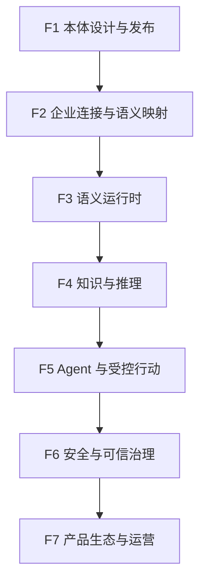
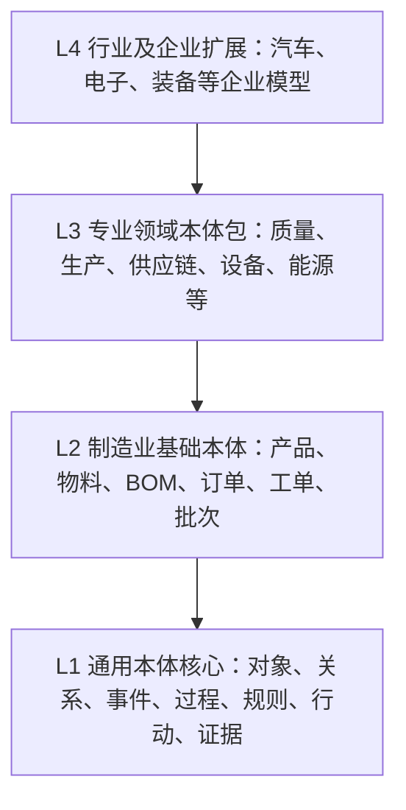
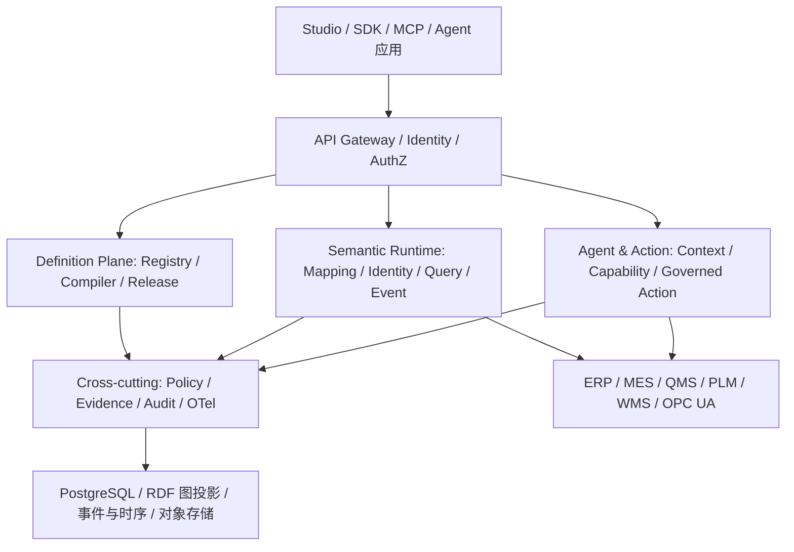
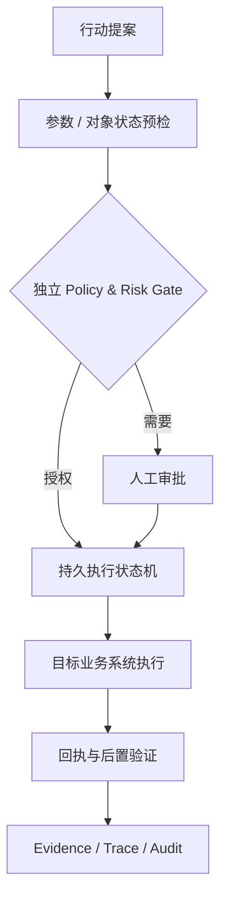

# 本体产品功能架构与技术架构设计 V1.0

> **产品建议名称**：Manufacturing & Industrial Ecosystem Ontology Platform（简称 MIE Ontology Platform，工作名称）  
> **文档类型**：产品功能架构与技术架构设计（评审基线）  
> **版本**：V1.0  
> **日期**：2026-10-14  
> **状态**：待产品与技术联合评审；不代表技术选型和实施授权均已签收  
> **适用项目**：[gitfortian/ontology-system](https://github.com/gitfortian/ontology-system)  
> **研究来源**：[Issue #1 — Jena / BKN Foundry 架构研究](https://github.com/gitfortian/ontology-system/issues/1)  
> **范围声明**：独立本体平台；不依赖 data-ops，不预设特定 ERP/MES/PLM/工业控制系统。

---

## 0. 执行摘要与架构决策速览

**产品定位**：构建“**通用本体核心 + 制造业及产业生态专业语义体系 + Agent 上下文与受控行动能力**”的企业本体平台。平台不只面向生产现场设备，也覆盖研发、采购、生产、质量、仓储、物流、能源、售后及经营协同；不替代这些领域现有业务系统，而是统一跨系统的业务对象、关系、状态、知识与行动语义。

**核心价值链**：定义业务对象 → 映射真实来源 → 形成实例与关系 → 获得当前及历史事实 → 结合规则与证据分析 → 向 Agent 提供可信上下文 → 经过策略门禁执行授权业务动作 → 核验结果并审计。

**V1.0 的五个关键结论**：

1. 底座采用独立于行业的类型系统、版本化本体模型及标准语义适配；制造业特色通过可安装的 Foundation / Domain / Industry 模型包形成。
2. 逻辑上区分 **Ontology Definition Plane（定义面）**、**Semantic Runtime Plane（运行面）**、**Agent & Action Plane（智能行动面）** 与横切治理；初期不强制物理微服务拆分。
3. 静态 Schema、实例关系、实时状态、历史时序、业务事件、知识证据与执行日志分别按负载选择存储；**稳定对象身份、时间语义和版本引用**负责统一。
4. Jena 用于 RDF / OWL / SHACL / SPARQL 等标准语义能力；产品 API 和核心对象契约不得与某一个图存储或 LLM 厂商绑定。
5. 首个黄金场景推荐 **制造质量异常 → 批次/物料追溯 → 受影响订单评估 → 质量处置 → 结果核验**；设备异常诊断作为第二个验证场景。

**本文件中的标识**：`确定方向` 表示产品定位已形成共识；`推荐方案` 表示当前首选、尚需 POC 验证；`待决策` 表示需要评审签收。任何组件版本、性能容量及场景上线阈值均应以试点实测为准。

## 1. 目标、边界与设计原则

### 1.1 产品要解决的问题

制造企业的数据与能力分散在 ERP、MES、PLM、QMS、WMS、EAM、SCADA、工业历史库和文档系统中。单一系统只理解自己的一部分对象；大模型虽然擅长语言理解，却缺乏稳定的业务对象身份、跨系统关系、可验证事实、工程规则和操作约束。

产品需要让 Agent 准确回答六类问题：**是什么**（对象与类型）、**有什么关系**（关系与影响路径）、**目前发生了什么**（状态与事件）、**为什么可能发生**（规则、知识与证据）、**可以做什么**（Capability）、**是否允许以及是否完成**（Policy、Action、Verification）。

### 1.2 目标客户与主要角色

| 角色 | 典型目标 | 核心工作台 |
|---|---|---|
| 企业架构师/领域专家 | 定义业务概念、关系与企业语言 | 本体设计、领域模型包 |
| 制造业务专家（质量、生产、供应链等） | 解释业务规则、验证模型与业务语义 | 领域建模、规则与场景评测 |
| 集成/数据工程师 | 把本体对象映射到 ERP、MES、QMS 等真实对象 | 连接中心、实体解析、映射调试 |
| Agent/应用开发者 | 按统一契约获得上下文和行动能力 | SDK、MCP、Context 调试、能力注册 |
| 运营/安全/平台管理员 | 管理权限、版本、风险、审计与服务质量 | 管理控制台、审批、审计、运维 |
| 一线业务人员 | 查询业务关系、溯源原因、执行授权处置 | 场景应用、对象详情、任务中心 |

### 1.3 范围与非目标

**范围内**：通用本体建模与发布；制造业及产业生态模型包；实例与跨系统标识；语义映射和查询；状态、事件与证据；规则推理；Agent Context、Capability、受控业务 Action；开放 API、SDK、MCP；安全、审计和部署运维。

**明确非目标**：不重做 ERP/MES/QMS/PLM；不要求全量复制企业业务数据；不把 RDF 图数据库等同于产品；不将 LLM 文字输出视作权威执行事实；不将图关系推理等同于因果诊断；不在首期提供 Agent 自主下发 PLC/DCS/SIS 物理控制命令；不以单一工厂设备场景定义整个产品。

### 1.4 架构原则

| 编号 | 原则 | 工程含义 |
|---|---|---|
| P-01 | 语义优先、对象为中心 | 对外契约以稳定的 Type/Entity/Relation/Action 标识组织 |
| P-02 | 通用核心与领域包分离 | 制造概念不硬编码到元模型引擎 |
| P-03 | 定义、实例、状态与执行分离 | 独立生命周期、存储与安全边界 |
| P-04 | 真相源明确、投影可重建 | Schema 发布物、源业务数据、审计事实各有权威来源 |
| P-05 | 可追溯且具时间语义 | 关键结论引用来源、观测时间、模型和规则版本 |
| P-06 | 权限在检索与执行前强制 | 拒绝通过推理、搜索、聚合或 MCP 旁路泄漏 |
| P-07 | 标准兼容、实现可替换 | Jena、存储、连接器、Agent 厂商均通过适配层隔离 |
| P-08 | 可用场景牵引，不堆砌微服务 | 先模块化、再按扩展和隔离需要拆服务 |

## 2. 功能架构

### 2.1 功能架构总览

本版定义 **七个功能域、二十三个一级模块**。相比研究 Issue 的 18 模块草案，新增并强化了业务流程语义、跨域影响分析、行业模型包与平台运营视角；原有本体、连接、运行时、Agent 和安全能力均保留。



| 功能域 | 一级模块及功能编号 | 交付结果 |
|---|---|---|
| F1 本体设计与发布（5） | F01 本体工作空间；F02 可视化本体建模；F03 约束与验证；F04 版本发布；F05 模型包与依赖 | 可复用、可审核、可发布的领域语义定义 |
| F2 企业连接与语义映射（3） | F06 连接器与源目录；F07 实体身份解析；F08 属性/关系/事件映射 | 企业真实对象可被统一识别和访问 |
| F3 语义运行时（4） | F09 实例与关系；F10 状态与事件；F11 语义查询；F12 业务过程与影响追溯 | 跨系统业务事实的统一读取与关联 |
| F4 知识与推理（3） | F13 文档知识与证据；F14 规则与推理；F15 诊断/影响分析 | 有依据、可解释的业务分析能力 |
| F5 Agent 与受控行动（3） | F16 Context Engine；F17 Capability Registry；F18 Action Runtime | 可信上下文、工具发现和执行闭环 |
| F6 安全与可信治理（2） | F19 语义权限与策略；F20 Evidence / Trace / Audit | 可授权、可追责、可审计 |
| F7 产品生态与运营（3） | F21 Studio / SDK / MCP；F22 制造领域模板库；F23 平台运行管理 | 可扩展、可部署、可运营的商业化产品 |

### 2.2 各功能域的核心要求

**F1 — 本体设计与发布。** 支持多工作空间、命名空间、类型、属性、关系、继承、基数、枚举、单位、对象状态、业务事件、业务过程、规则、能力与行动声明；提供图形/结构化双视图、引用查找、语义 Diff、静态校验、SHACL 校验、影响分析、审批发布、依赖锁定、跨环境打包与回滚。编辑器的可视化是生产工具，不以“自由画图”代替类型约束。

**F2 — 企业连接与语义映射。** 连接 ERP/MES/PLM/QMS/WMS/EAM、SQL、REST/OpenAPI、消息系统，工业现场 OPC UA/历史库以专用适配器接入。定义外部主键、稳定语义 ID、属性映射、关系映射、事件映射和增量/失效策略，提供预演、冲突检测、映射质量检查与来源漂移提示。

**F3 — 语义运行时。** 支持实体检索、实例子图、关系路径与跨源聚合；状态必须具有观测时间、入库时间、来源、质量、单位和时效。业务过程支持阶段、事件、输入/输出对象的追踪；跨域影响分析以明确的关系和证据链为基础，不得将推测关系默认当成事实。

**F4 — 知识与推理。** 将 SOP、工艺卡、质量标准、维修记录、变更记录等作为可版本化、带授权与来源的知识资产。分别支持类型推理、SHACL 验证、确定性业务规则、专业算法/统计模型；规则执行结果需要包含规则版本、输入事实、适用条件和解释。

**F5 — Agent 与受控行动。** Agent 按 `Schema → Entity/Subgraph → State/Evidence → Capability` 渐进加载信息；能力与具体工具绑定解耦；Action 具有输入输出 Schema、对象适用条件、风险级别、授权、审批、幂等、执行状态、回执及效果核验。Action 可调用既有业务系统，但不能绕开其权限与审批。

**F6 — 安全与可信治理。** 身份、租户、工作空间、对象、属性、关系、知识与 Action 采用统一授权上下文；过滤必须作用于检索规划和推理输入，而不只是最终结果展示。Trace 记录实际调用事实、执行状态、错误和证据引用；禁止从 LLM 最终回答反向生成“成功执行”的审计记录。

**F7 — 产品生态与运营。** Studio 采用面向任务的工作流程（新建模型、导入包、绑定系统、验证、发布、查看实例、分析、行动）；SDK/MCP 公开受限能力；行业包支持依赖、版本及兼容检查；运维中心覆盖部署、健康、配额、备份、恢复、升级和许可证清单。

### 2.3 产品页面与用户主线

| 一级导航 | 代表页面 | 用户应能完成的任务 |
|---|---|---|
| 首页 / 工作台 | 项目概况、模型健康、连接异常、待审批、Agent 活动 | 判断当前本体建设与运行状况并进入下一步 |
| 本体设计 | 本体目录、类型/关系编辑、规则、版本发布 | 建模、验证和发布 |
| 业务实体 | 实体目录、对象详情、关联图、生命周期 | 从业务对象直接访问关系与事实 |
| 连接与映射 | 系统连接、Schema 浏览、身份/属性映射、差异审阅 | 将定义映射到真实来源 |
| 语义查询 | 对象搜索、路径探索、关系查询、影响追踪 | 查清跨域对象和业务影响 |
| 知识与规则 | 知识库、规则、验证报告、解释结果 | 管理专家知识并验证推理 |
| Agent 与行动 | Context 调试、能力目录、行动审批、执行记录 | 测试上下文、运行受控行动 |
| 模型资产与管理 | 领域模型包、安装更新、权限审计、平台监控 | 治理复用、发布与运维 |

建模黄金流程：`创建工作空间 → 选择制造业基础包 → 定义/扩展对象 → 定义关系与规则 → 绑定业务系统 → 预览实例与校验 → 发布版本 → 通过 SDK/MCP 使用 → 观察运行结果`。

### 2.4 优先级与最低可用范围

| 分类 | P0 必须具备 | 后续演进 |
|---|---|---|
| 本体 | 类型/关系/属性/约束、DSL/AST、导入导出、版本发布 | 多分支协作、复杂兼容分析、模型市场 |
| 制造业特色 | 产品、物料、BOM、订单、工单、批次、质量事件的基础模型包 | 设备、供应链、PLM、能源等专业包 |
| 连接 | PostgreSQL/REST 与少量 ERP/MES/QMS 样例绑定 | 连接器目录、OPC UA、历史库、CDC |
| 运行 | 实例、关系、基本事件、来源/时间查询 | 时序和流式事件、复杂跨源优化 |
| Agent | 只读 Context、Schema/实例检索和 SDK | 规则辅助诊断、Action 生命周期与 MCP 增强 |
| 安全 | 身份/租户隔离、读写权限、发布审计 | 字段/关系策略、风险策略组合、审批自动化 |

## 3. 核心元模型与制造业扩展体系

### 3.1 四层本体结构



| 层级 | 内容 | 扩展规则 |
|---|---|---|
| L1 通用本体核心 | Type、Entity、Relation、Property、State、Event、Process、Rule、Action、Policy、Evidence | 平台内核稳定、行业无关 |
| L2 制造业基础本体 | 企业/工厂、组织、产品、物料、BOM、设备、生产资源、订单、工单、批次、质量对象 | 官方基础包、规范化语义 ID |
| L3 专业领域本体包 | 研发、采购、供应链、生产、质量、仓储、设备、能源、售后 | 可组合、显式依赖与版本边界 |
| L4 行业/企业扩展包 | 汽车、电子、装备、流程制造等行业模型；企业专属对象 | 通过继承/扩展和映射配置接入，不改 L1 代码 |

**设计要点**：标准（ISA-95、OPC UA、AAS、SOSA/SSN、PROV-O 等）以映射与互操作为主，不强制直接成为平台唯一元模型；制造业包引用标准术语时应记录标准来源与适用版本。

### 3.2 核心实体定义

| 元概念 | 关键字段（示意） | 约束 |
|---|---|---|
| OntologyPackage | package_id、version、dependencies、checksum | 不可变发布物，依赖版本锁定 |
| EntityType | type_id、name、parent_types、properties | 稳定逻辑 ID，支持显式兼容策略 |
| Entity | entity_id、type_id、lifecycle_state | 身份不随外部系统主键变化而变化 |
| RelationType | relation_type_id、source_type、target_type、cardinality | 方向、约束与关系有效期明确 |
| RelationFact | subject、predicate、object、valid_time、provenance | 保留事实来源与有效时间 |
| PropertyDefinition | data_type、unit、required、mapping、sensitivity | 不能把映射信息写死到语义定义中 |
| Observation / State | value、unit、observed_at、quality、source | 区分当前值与历史观测；不保存为无时效字符串 |
| Event | event_type、subject、occurred_at、payload、source | 业务事件与设备报警共享上层事件契约 |
| ProcessDefinition | stages、inputs、outputs、transition_rules | 可描述订单履约、生产工序、质量处置等 |
| RuleDefinition | trigger、conditions、logic、outputs、version | 明确推导性质和适用范围 |
| CapabilityDefinition | target_type、input_schema、output_schema、binding | 逻辑能力与环境局部 Tool ID 分离 |
| ActionDefinition | preconditions、risk、approval、idempotency、verification | 描述行为，授权由运行时独立判定 |
| PolicyDefinition | subject、resource、operation、conditions、effect | 默认拒绝、显式审计及可测试 |
| EvidenceReference | source_ref、timestamp、schema_version、hash | 事实、规则、知识片段与调用链均可追溯 |

**必须遵循**：`EntityType != Entity`；`State != PropertyDefinition`；`ActionDefinition != Execution`；`Inference != Observation`。同一对象可随时间变化，但其模型发布版本和真实数据源生命周期不能混为一谈。

### 3.3 跨域制造业关系样例

| 关系 | 源 → 目标 | 典型用途 |
|---|---|---|
| containsComponent | Product → BOMItem | 产品结构与受影响部件分析 |
| specifiesMaterial | BOMItem → Material | 质量批次与物料关联 |
| suppliedBy | MaterialLot → Supplier | 上游供应追溯 |
| consumedIn | MaterialLot → ProductionOrder | 物料批次到生产工单 |
| produces | ProductionOrder → ProductLot | 生产工单到成品批次 |
| hasInspection | ProductLot → Inspection | 成品质量检验 |
| fulfills | ProductLot → CustomerOrder | 质量问题到受影响订单 |
| executedAt | ProductionOperation → Equipment | 工艺与设备影响的可选关联 |

上述关系是行业模板示意，并非宣称所有企业存在统一命名或一致业务约束。实际产品应允许多粒度、多个来源和随时间变化的关系。

### 3.4 版本、兼容与回滚

模型生命周期建议：`Draft → Validate → Review → Publish → Deprecate / Rollback`。发布生成不可变 Artifact，包含 DSL、规范化 AST、依赖锁文件、SHACL、RDF 投影、迁移兼容报告、Checksum。对外使用 `package_id@version` 或 `release_id`，禁止仅用可变 `latest` 指向关键审计证据。

区分 **Schema 回滚**、**映射回滚**、**实例投影重建**、**业务系统动作补偿**。Schema 发布回滚不能自动撤销已经创建的工单、变更的订单状态或现场执行结果。类型字段删除、关系基数改变、能力输入契约变更都需要兼容与影响分析。

### 3.5 推荐声明式模型示例

```yaml
package: mie.quality-foundation
version: 1.0.0
requires:
  - mie.manufacturing-core@^1.0
entityTypes:
  - id: ProductLot
    label: 产品批次
    properties:
      - { id: lotNo, type: string, required: true }
      - { id: qualityStatus, type: enum, values: [pending, passed, held] }
relationTypes:
  - id: fulfills
    source: ProductLot
    target: CustomerOrder
    cardinality: many-to-many
capabilities:
  - id: assess_quality_impact
    appliesTo: ProductLot
    inputSchema: schemas/impact-input.json
    outputSchema: schemas/impact-output.json
```

这是 **本方案拟定义的示例 DSL**，不是 Jena、BKN 或现有项目已经实现的格式。正式 DSL 应有可机器校验的 JSON Schema/AST 规范，并明确引用、命名空间、循环依赖和语义版本规则。

## 4. 总体技术架构

### 4.1 逻辑架构总图



**定义面** 管理 Schema 真相、编译和发布；**运行面** 负责实例解析、来源查询、观测事件与关系查询；**智能行动面** 负责 Agent 的上下文和授权执行；**治理面** 提供身份、策略、版本、证据和运行可观测性。逻辑边界不要求所有模块各自部署成微服务。

### 4.2 后端模块边界（建议的限界上下文）

| 模块 | 核心职责 | 禁止承担的职责 |
|---|---|---|
| ontology-registry | 工作空间、类型、模型包、依赖元数据 | 直接向生产业务系统发送行动 |
| ontology-compiler | DSL/AST、类型检查、SHACL、RDF 投影、兼容报告 | 直接依赖单一图数据库作为模型真相源 |
| release-manager | 验证、审核、发布、回滚、投影状态 | 静默修改已发布不可变包 |
| identity-mapping | 多源身份绑定、歧义处理、映射质量 | 擅自覆盖原系统主数据 |
| instance-graph | 实例、关系事实、时态与来源视图 | 把高频时序全量写作永久语义三元组 |
| semantic-query | 查询规划、权限感知、跨源读取、来源证据 | 越权读取物理表并绕开字段过滤 |
| entity-runtime | 状态、事件、质量、时间窗口、缓存失效 | 把陈旧观测标识为当前可靠值 |
| knowledge-rule | 知识索引、验证、规则执行与解释 | 把规则输出直接当成已证实因果原因 |
| agent-context | 分层 Schema/实体/事实/能力加载 | 拥有全域超级用户数据库连接 |
| capability-registry | 能力声明、SDK/MCP 工具契约及环境绑定 | 决定最终动作授权结果 |
| action-runtime | 策略判定、审批、执行状态机、回执、补偿 | 绕开目标系统和现场安全措施 |
| authz-evidence | 授权、审计、证据签名/关联与留存 | 从 Agent 文本臆造执行事实 |

### 4.3 关键数据流和控制流

1. **建模发布流**：Studio 提交草稿 → Compiler 静态/语义校验 → 生成不可变发布物 → Review → Release Manager 更新活动版本指针 → 重建图/搜索/查询投影 → 审计。
2. **语义查询流**：用户/Agent 携带租户与身份 → AuthZ 限制可见 Schema 与资源 → Query Planner 选择图关系、业务 API 和实例缓存 → 聚合带来源/时态的结果 → 返回 Evidence。
3. **状态事件流**：连接器接收 API/消息/工业观测 → 身份映射 → 单位和质量转换 → Event/State Runtime → 缓存或时序落盘 → 更新事件关联；晚到、断连和失败恢复须可检测。
4. **行动闭环流**：Agent 提交 ActionRequest → 重新获取授权与必要的最新状态 → Policy/Risk Gate → 审批/持久执行 → 目标系统回执 → 结果核验 → Trace/Evidence。不得因 Agent 判断“安全”跳过门禁。

### 4.4 真相源与数据存储职责

| 数据类别 | 权威来源 | 推荐物理介质 | 重建/一致性策略 |
|---|---|---|---|
| 本体定义与版本 | 已发布 DSL/AST Artifact + Release Registry | 对象存储 + PostgreSQL | 按发布物重编译投影；保留版本指针 |
| 实体身份与映射 | 平台 Identity Registry；外部主数据仍归源系统 | PostgreSQL | 绑定历史、歧义人工确认、映射版本 |
| 静态关系与语义图 | 原业务来源或平台审核后的事实 | RDF 图投影 / 关系索引 | 通过来源变更、事件与版本重建 |
| 动态状态与历史观测 | 设备/业务原系统或授权 Historian | 时序库/缓存/联邦查询 | 质量标记、时效、窗口边界、回填策略 |
| 事件 | 源业务事件及接入审计 | 事件库/消息流 | 去重、顺序约束、重放与死信处理 |
| 文档和知识 | 版本化来源文档 | 对象存储、全文/向量索引 | 权限同步、引用源片段和版本 |
| Action 执行事实 | 平台执行引擎与目标系统回执 | PostgreSQL + append-only Audit | 幂等键、持久状态、对账与不可篡改留存 |

**一致性原则**：不假设 PostgreSQL、TDB2、时序库和外部系统之间有天然分布式事务。通过不可变 release、Outbox/Event、投影状态机、幂等重放与修复工具实现可恢复的一致性。读取接口应暴露使用的 `schema_release_id` 和必要的 `as_of` / `observed_at`。

## 5. 关键后端技术栈与组件决策

### 5.1 推荐技术栈

| 分层 | 首选 / 候选 | 适用性与引入时机 |
|---|---|---|
| 核心语言与框架 | Java 21 + Spring Boot | 与 Apache Jena / OPC UA Java 生态配合；第一版主服务 |
| 架构风格 | 模块化单体 + Hexagonal / Ports & Adapters | 初期减少物理服务与事务开销；清晰依赖方向 |
| 标准语义 | Apache Jena Core / ARQ / SHACL / OntAPI（适用范围内） | RDF、SPARQL、验证与互操作；隔离实现细节 |
| RDF 存储 | Jena TDB2（POC/中小规模） | 图投影与标准查询；性能、写并发需评测 |
| 事务与配置存储 | PostgreSQL | 工作空间、元模型注册、发布、映射、Action 状态 |
| 时序 | 原 Historian 优先；必要时 TimescaleDB | 并非通用内核的强制依赖 |
| 文件与发布物 | S3 / MinIO | DSL 包、快照、知识文档和证据附件 |
| 缓存 | Redis（可选） | 对象热状态、幂等辅助、短生命周期缓存 |
| 消息总线 | Kafka / Redpanda（按规模引入） | 跨系统事件、Outbox 消费、异步投影 |
| 查询/搜索 | PostgreSQL FTS + pgvector；需时 OpenSearch | 概念、文档与语义检索；先验证规模 |
| 工业适配 | Eclipse Milo（OPC UA）；REST、JDBC、消息适配 | OPC UA 为工业领域插件，非平台强制基础服务 |
| 业务工作流 | 数据库持久状态机；复杂长流程评估 Temporal | 审批、回执、补偿；避免依赖内存重试 |
| AI 算法服务 | Python / FastAPI（按需） | 统计/诊断/Embedding/特定行业算法，不侵入核心真相源 |
| Agent 接口 | REST / OpenAPI / MCP / Java、Python SDK | 固定数据契约，不与模型/Agent 框架绑定 |
| IAM/策略 | OIDC/OAuth2 + 可插拔 PDP（OPA 候选） | 身份、对象/属性/关系/Action 强制判权 |
| 可观测性 | OpenTelemetry、Prometheus、Grafana | 跨 API、Context、Action 和连接器全链路追踪 |
| 部署 | Docker Compose（开发）/ K8s（按生产需要） | 支持私有化与网络隔离的工厂接入网关 |

**技术选型边界**：Jena 的 OntAPI 表达范围不等于内置推理器支持完整 OWL 2 DL；SHACL 不等于业务权限或工业安全；TDB2 非分布式工业时序库。第一版不应同时部署多套图数据库，也不应把向量检索当成确定性关系查询的替代品。

### 5.2 工程目录建议（模块化单体）

```text
ontology-system/
  apps/
    ontology-platform/          # Spring Boot 主应用
    connector-gateway/          # 可独立部署的连接/映射网关
    agent-diagnostics/          # 按需 Python 推理/分析扩展
  modules/
    ontology-core/              # 模型、领域接口、类型规则
    ontology-compiler/          # DSL AST / RDF / SHACL / 版本兼容
    ontology-release/           # 生命周期和发布投影
    identity-mapping/           # 实体身份与来源绑定
    semantic-query/             # 查询规划与权限过滤
    entity-runtime/             # 实例、状态、事件
    knowledge-rules/            # 知识、规则和推理适配
    agent-context/              # Context assembly
    capability-registry/        # 逻辑能力和环境绑定
    action-runtime/             # 持久执行、审批、回执
    security-evidence/          # AuthZ、Provenance、Trace
  adapters/
    rdf-jena/ db-postgres/ object-storage/
    jdbc/ rest/ mqtt/ opcua/ cmms/ erp/ mes/ qms/
  packs/
    mie-manufacturing-core/
    mie-quality-traceability/
    mie-production/
    mie-equipment/
  contracts/
    openapi/ json-schema/ mcp/ events/
  deployments/ docs/ tests/
```

**依赖纪律**：领域层定义 Port 和 DTO；基础设施适配器只能向内依赖；Context 不能绕过 Semantic Query/Policy 直接读取数据库；Action 始终走 Policy Gate；业务模型包不能依赖外部数据连接器的内部类。

### 5.3 部署剖面

| 剖面 | 组件 | 用途 |
|---|---|---|
| Dev / POC | 主应用、PostgreSQL、TDB2、对象存储；少量 Mock/REST 连接器 | 完成本体发布、基础实例查询与 SDK |
| Pilot | 加连接网关、身份映射、QMS/MES/ERP 接口、审计及必要消息机制 | 质量追溯黄金场景真实验证 |
| Production | 视压力加多实例查询服务、持久工作流、备份恢复、隔离网关、集中监控、灾备 | 企业生产级运行，按 SLO 与合规评估 |

图数据持久化和业务读写的高可用方案需单独实测；不能把“部署 Kubernetes”当作数据库自动高可用的证据。

## 6. 语义运行时和数据契约

### 6.1 统一身份模型

建议稳定语义 ID 为 `urn:mie:{tenant}:{domain}:{type}:{id}` 的逻辑结构（实际字符规则需 ADR 确定）。映射记录包含：`entity_id`、`source_system`、`external_type`、`external_key`、`confidence/match_method`、`valid_from/to`、`mapping_version`、`verified_by`。自动匹配不得静默覆盖已人工确认的身份绑定。

### 6.2 Observation / Event / State 契约

状态读取至少返回对象、属性、值、单位、观测时间、获取时间、质量、来源、当前是否陈旧、关联的模型版本；事件至少返回事件类型、业务主体、事件发生时间、到达时间、来源 ID 和去重键。对迟到事件、重复事件和时钟偏差要显式说明处理策略。

### 6.3 查询和上下文 API（草案）

| 接口（示意） | 目的 | 最低安全/响应契约 |
|---|---|---|
| `POST /v1/ontologies/{id}/validate` | 验证本体草稿 | 错误定位、影响对象、校验规则 ID |
| `POST /v1/ontologies/{id}/releases` | 发布模型版本 | 依赖锁、审阅人、发布物哈希、幂等键 |
| `GET /v1/entities/{id}` | 读取实例 | 资源授权、schema_release_id、来源 |
| `POST /v1/semantic/query` | 查询对象与关系 | 查询预算、字段/关系过滤、来源快照 |
| `POST /v1/context/assemble` | 为 Agent 组装上下文 | 主体身份、用途、时态、证据列表、Token 预算 |
| `GET /v1/capabilities` | 发现当前适用能力 | 对象/租户/策略过滤、参数契约版本 |
| `POST /v1/actions/proposals` | 创建动作提案 | 对象快照、风险、授权、校验和审批要求 |
| `POST /v1/actions/{id}/execute` | 授权执行动作 | 新鲜状态预检、审批、幂等、回执引用 |
| `GET /v1/actions/{id}` | 查询动作状态 | 原始执行事实、核验状态和 Trace ID |

上述为**概念级 API 提案**，非已实现路由。公开接口采用稳定契约与版本策略，所有 Query、Context、Action 在服务端独立执行身份与资源授权。

### 6.4 Agent Context 的渐进加载

**L1 Schema Discovery**（查找与问题相关的类型/关系）→ **L2 Entity & Subgraph**（受限实例与路径）→ **L3 State / Events / Knowledge**（必要时态、来源、证据）→ **L4 Capability & Action**（当前对象有权使用的能力、约束和适用工具）。

Context 响应建议返回：`schema_release_id`、`scope`、`as_of`、`entities`、`facts`、`evidence_refs`、`capabilities`、`omissions`（权限/时效/数据缺失）、`context_trace_id`。模型输出的解释不可替代证据与执行记录。

## 7. 受控行动、权限与可信体系

### 7.1 Action 标准状态机



**Action 生命周期**：`Proposed → Validated → Authorized → [ApprovalRequired] → Scheduled/Executing → Succeeded/Failed/Unknown → Verified/NeedsReview`。网络超时且无法确认外部副作用时应进入 **Unknown/NeedsReview**，不可自动宣称失败并盲目重试。业务补偿由动作契约显式定义，不能默认所有操作可回滚。

### 7.2 风险层级

| 等级 | 能力举例 | 控制要求 |
|---|---|---|
| L0 只读 | 查看订单、设备、库存、趋势、知识 | 身份与细粒度只读授权 |
| L1 分析建议 | 质量影响范围、故障假设、供应风险 | 证据、不确定性、适用条件 |
| L2 业务写操作 | 发起质量处置、创建检修/采购工单 | 授权、幂等、审计；按风险审批 |
| L3 经营/生产决策执行 | 修改计划、锁定批次、释放库存 | 预检、强审批、回执和后置核验 |
| L4 物理控制 | 启停设备、修改关键设定值 | MVP 禁止 Agent 自主执行；未来需独立 OT 安全评估和现场控制约束 |

等级划分为产品建议模型，并不能自动替代企业 EHS、质量体系、工厂 OT 安全规范或其他法定责任。

### 7.3 语义授权

授权对象至少涵盖：Ontology/Release、Type、Entity、Property、Relation、Knowledge、Rule、Capability、Action、Evidence。必须同时约束列表总数、搜索命中、路径扩展、推理输入、聚合中间结果、缓存键和 Trace 读取。跨租户身份复用、撤权后缓存泄漏、MCP 工具越权、关系侧信道均列为安全测试门槛。

### 7.4 证据链与审计事实

每次关键分析应保留 `who`、`why/task`、`model_version`、`source_fact_refs`、`rule/model version`、`timestamps`、`policy_decision`、`result`；每次外部动作还需保留 `idempotency_key`、`approval_actor`、`request/response boundary`、`attempts`、`external_receipt` 和 `verification`。审计事件来源于服务端实际执行边界，而不是 Agent 生成的自然语言。

## 8. 黄金用户故事与端到端验收

### 8.1 主要黄金故事：制造质量异常闭环

**场景**：QMS 发现产品批次 `LOT-A100` 检验不合格。业务人员希望知道涉及哪些物料批次、供应商、生产工单、库存、客户订单，并对有权限的批次发起质量处置。

| 步骤 | 产品行为 | 关键验收点 |
|---|---|---|
| 1 建模 | 从制造基础包扩展 ProductLot、MaterialLot、Supplier、ProductionOrder、CustomerOrder、Inspection | 模型类型与关系可通过 Schema 校验并发布 |
| 2 绑定 | 从 QMS、MES、ERP/WMS 绑定批次、工单和订单 | 身份匹配来源明确；冲突/歧义可处理 |
| 3 触发 | 接收不合格事件或按需查询 | 事件时间、来源、去重正确 |
| 4 追溯 | 从 LOT-A100 沿消耗/生产/交付关系扩展影响子图 | 路径解释可回溯；未知关联不能填充臆测关系 |
| 5 分析 | 应用质量规则、知识和业务状态评估受影响范围 | 规则版本、缺失信息、证据齐备 |
| 6 Agent 建议 | 输出受影响批次/订单、处置建议与依据 | 无权事实不泄漏；不确定性标识清晰 |
| 7 授权行动 | 申请锁定批次或创建质量处置单 | 动作独立判权、审批/幂等/执行回执 |
| 8 闭环核验 | 查询处置单和批次状态 | 状态真实、失败可恢复、Trace 可核对 |

### 8.2 第二黄金故事：设备异常与检修

从设备、测点和工况建立对象关系，读取授权范围内的 OPC UA/历史趋势、质量标记与 SOP，生成有证据的故障假设，创建检修工单并验证结果。该场景用于验证工业连接插件、时序语义和现场安全边界，**不决定通用核心的边界**。

### 8.3 验收基准与衡量方法

| 维度 | 必测内容 | 证据要求 |
|---|---|---|
| 模型正确性 | 继承、约束、变更影响、依赖和发布回滚 | 自动化 Schema/SHACL 测试、发布报告 |
| 实体映射 | 同名异物、异名同物、冲突、来源漂移 | 映射对账报告与人工纠错记录 |
| 查询可信性 | 权限、路径、跨源一致性和来源完整度 | 查询测试集、证据路径与审计事件 |
| 动态数据 | 迟到、重复、无效质量、陈旧缓存、断连恢复 | 时间/质量测试与故障注入记录 |
| Agent 可信性 | 证据缺失、工具拒绝、检索越权、错误归因 | 黄金问答集、专家评分、权限回归 |
| 行动可靠性 | 重复请求、超时未知、审批失效、撤权、外部回执 | 状态机测试、回放/对账报告 |
| 可运营性 | 健康监测、备份恢复、扩容、版本升级 | 试点 SLO、故障演练和恢复记录 |

不得仅以“演示成功一次”作为生产验收。响应时间、准确率、误报率、对象容量、时效和 RTO/RPO 等具体阈值在试点需求调研与容量基线测试后确定。

## 9. 分阶段实施路线与交付门槛

| 阶段 | 核心交付 | 对应 Gate / 必要证据 | 不做事项 |
|---|---|---|---|
| P0 模型基础 | 核心元模型、DSL/AST、编译/验证、版本发布、基础 Studio、制造基础包 | G0：模型发布、依赖、回滚和基础实例演示通过 | 不做复杂 Agent 和多引擎 |
| P1 跨系统语义 | QMS/MES/ERP 的样例连接、身份解析、实例关系、业务事件、查询 | G1：批次→工单→订单跨系统追溯、权限与来源测试通过 | 不强制接入所有工业协议 |
| P2 知识与 Agent | 知识证据、规则、Context、SDK/MCP、黄金场景评测 | G2：可追溯的 Agent 分析、无权拒绝与错误解释回归通过 | 不开放自治物理操作 |
| P3 受控行动 | Capability、Action、Policy Gate、审批、持久状态、核验 | G3：授权、幂等、未知状态恢复、审计闭环通过 | 不绕过业务系统安全 |
| P4 行业化与产品化 | 领域模型包、模板市场、迁移兼容、性能/可用性、运维与多工厂复制 | G4：跨环境重绑定、升级、容灾和运维验证通过 | 不为了大而全牺牲可维护性 |

阶段是能力依赖顺序，不是硬性的日历承诺。P0/P1 期间可同步建设简单安全控制和审计基础；P3 的业务 Action 需要先完成并实际通过风险与权限 Gate。

### 9.1 交付件清单

- 产品：PRD、用户故事地图、Studio 信息架构、黄金场景脚本。
- 领域：元模型规范、制造基础包、领域包依赖规范、示例业务对象集。
- 技术：DSL/AST Schema、API/OpenAPI、MCP Tools Schema、事件契约、Action 状态机、权限矩阵。
- 运维：部署剖面、故障恢复、备份策略、审计规范、容量评测。
- 质量：契约测试、真实系统联调、权限/安全回归、故障注入与黄金场景验收。

## 10. 架构决策记录（ADR）与待评审问题

| ADR | 议题 | V1.0 推荐 | 状态 |
|---|---|---|---|
| ADR-01 | 产品定位与边界 | 通用本体核心 + 制造生态特色 + Agent 受控行动 | 确定方向 |
| ADR-02 | 首个切入场景 | 制造质量异常跨系统追溯；设备诊断第二场景 | 推荐方案 |
| ADR-03 | 模型真相源 | 不可变 DSL/AST Artifact + Registry；RDF 为投影 | 待 POC |
| ADR-04 | 标准语义引擎 | Jena / RDF / OWL / SHACL / SPARQL | 推荐方案 |
| ADR-05 | 图存储边界 | 初期 TDB2；不直接承载高频时序 | 待压测 |
| ADR-06 | 身份解析与时态 | 稳定对象 ID、有效时间、来源映射版本 | 推荐方案 |
| ADR-07 | 跨源查询 | 语义虚拟化优先、图和缓存按需物化 | 待 POC |
| ADR-08 | Agent Context | 权限感知四层渐进加载、证据和版本引用 | 推荐方案 |
| ADR-09 | Action 安全 | 独立 Policy Gate、审批、幂等与回执核验 | 必须满足 |
| ADR-10 | 部署风格 | 核心模块化单体 + 可分离连接网关 | 推荐方案 |
| ADR-11 | 制造领域包 | Core / Foundation / Domain / Enterprise 四层 | 推荐方案 |
| ADR-12 | 标准映射 | ISA-95、OPC UA、AAS 等作为互操作参考 | 待范围确认 |
| ADR-13 | 许可证与代码复用 | Jena 等按许可复用；BKN 混合许可逐文件核查 | 必须审查 |
| ADR-14 | 平台一致性 | Schema 发布、实例映射、运行时快照及动作记录分离 | 推荐方案 |

**实施前至少签收**：ADR-02（样例场景与系统）、ADR-03（DSL/AST 规范）、ADR-06（身份 ID 与时态）、ADR-09（Action 安全）、ADR-11（制造基础包最小范围）、ADR-13（复用合规）。

## 11. 风险登记与应对

| 风险 | 影响 | 控制措施 |
|---|---|---|
| 过早抽象成通用万能本体 | 无法形成制造行业差异化 | 以质量追溯黄金场景驱动最小元模型 |
| 过度工业物联网化 | 忽略订单、供应链、研发等业务对象 | 首场景跨 QMS/MES/ERP；工业连接作为插件 |
| RDF 与业务 Schema 双真相 | 版本漂移、难以恢复 | DSL/AST 发布物权威化；投影可重建 |
| 关系和身份映射错误 | 错误追溯与 Agent 误判 | 稳定 ID、来源置信度、人工复核和时态对账 |
| Agent 越权和幻觉行动 | 安全事故或业务损失 | 策略在工具与服务端强制；只承认执行边界事实 |
| 复杂系统过早微服务化 | 代码膨胀和交付缓慢 | 模块化单体先行，基于证据拆分 |
| 工业现场连接与云耦合 | 网络/OT 风险 | 独立网关、分区、最小权限、只读优先 |
| 开源授权混用 | 商业再发布风险 | SBOM、许可证审查和复用边界记录 |

## 12. 参考资料与研究来源

1. [ontology-system Issue #1：工业本体 / Apache Jena / BKN Foundry 架构研究](https://github.com/gitfortian/ontology-system/issues/1)（2026-10-13；本设计的研究输入，结论并非全部已实现）。
2. [Apache Jena 官方文档](https://jena.apache.org/documentation/)；[TDB2 文档](https://jena.apache.org/documentation/tdb2/)；[TDB 事务说明](https://jena.apache.org/documentation/tdb/tdb_transactions.html)。
3. [gitfortian/bkn-foundry](https://github.com/gitfortian/bkn-foundry)（BKN Lang、Context Loader、Capability Binding、Trace、权限模式的参考；代码复用需许可证审查）。
4. [ISA-95 / IEC 62264 官方介绍](https://www.isa.org/standards-and-publications/isa-standards/isa-95-standard)。
5. [OPC Foundation Companion Specifications](https://opcfoundation.org/about/opc-technologies/opc-ua/ua-companion-specifications/)。
6. [IDTA / Asset Administration Shell 相关规范](https://industrialdigitaltwin.org/en/content-hub/aasspecifications)。
7. [W3C SHACL](https://www.w3.org/TR/shacl/)；[OWL 2](https://www.w3.org/TR/owl2-overview/)；[PROV-O](https://www.w3.org/TR/prov-o/)；[SOSA/SSN](https://www.w3.org/TR/vocab-ssn/) 。
8. [NIST SP 800-82 Rev.3 — Guide to Operational Technology (OT) Security](https://csrc.nist.gov/pubs/sp/800/82/r3/final)。

---

**结论**：V1.0 的架构基线是“**通用的语义与行动内核、专业的制造业知识模型包、独立的企业语义运行时、可信的 Agent Context 与安全执行闭环**”。它是一款独立的本体产品，而非工业物联网平台、企业业务系统替代品或单纯的 RDF 编辑器。正式开发拆分应以 ADR 签收和 P0/P1 黄金故事验收标准为先决条件。

## 附录 A. 正式架构评审签收清单

本表用于联合产品、技术、业务与安全负责人评审，**当前全部为待签收状态**。只有通过相关 Gate 后方可将架构提案拆分为承诺交付的开发任务。

| 评审项 | 签收需要确认的内容 | 当前状态 |
|---|---|---|
| 产品定位 | 通用内核、制造业特色、独立产品边界及首个黄金场景 | 待签收 |
| 功能架构 | F01–F23 的职责、遗漏项、前端工作流及先后依赖 | 待签收 |
| 领域模型 | L1–L4 分层、最小制造基础包、业务过程、类型与实例边界 | 待签收 |
| DSL 与版本 | AST 权威格式、标识规范、校验门禁、Diff、发布与回滚 | 待 POC 后签收 |
| 运行时一致性 | 身份解析、跨源查询、时态、缓存、投影重建和漂移处理 | 待 POC 后签收 |
| 技术选型 | Jena/TDB2 适用性、存储负载、部署剖面与开源许可 | 待技术评审 |
| Agent 与行动 | 上下文可见性、Action 契约、策略门禁、审批、回执与未知状态 | 待安全评审 |
| 试点验收 | QMS/MES/ERP 样例范围、测试数据、业务专家和 Gate 指标 | 待场景评审 |

**实施启动前置条件**：① 确定试点业务系统和数据可用性；② 冻结 P0 核心元模型与 DSL/AST 的最小规范；③ 签收 ADR-02/03/06/09/11/13；④ 确认安全责任人与黄金故事验收人；⑤ 建立 POC 和回归测试清单。

**下一份设计产物**：`核心本体元模型与 DSL/AST 契约 V0.1`，用于将本 V1.0 的产品架构转化为可实现、可验证的对象结构、类型规则、校验器与发布接口。